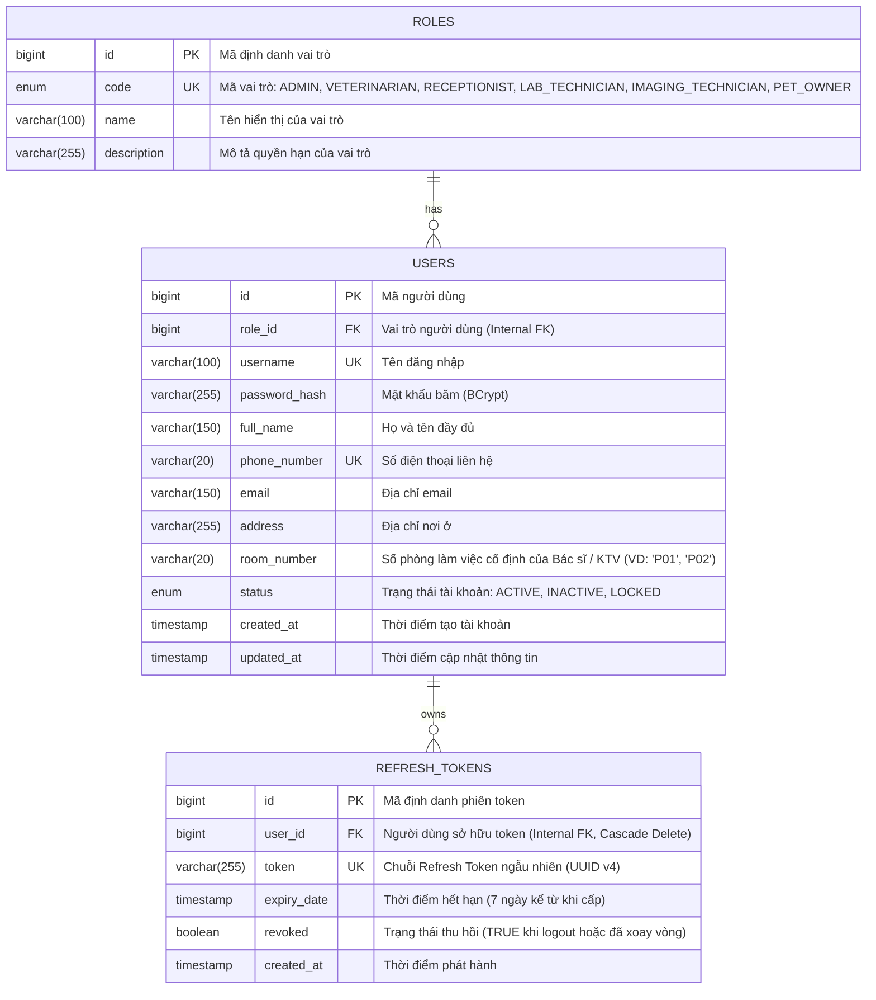
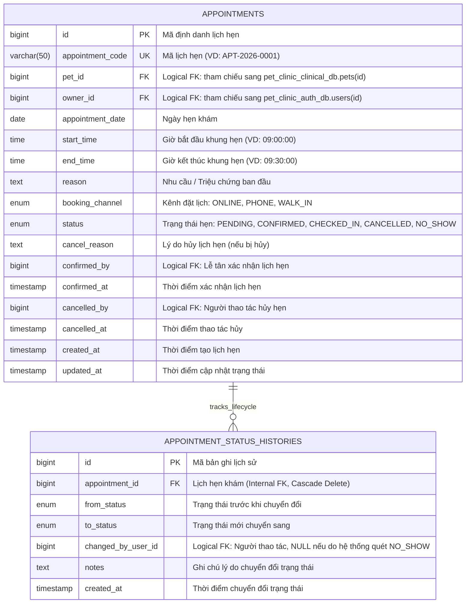

# TÀI LIỆU THIẾT KẾ CƠ SỞ DỮ LIỆU (ERD & DATA DICTIONARY)
## HỆ THỐNG QUẢN LÝ PHÒNG KHÁM THÚ Y (MICROSERVICES ARCHITECTURE)

> **Mô hình kiến trúc:** Microservices Architecture (Database-per-Service Pattern)  
> **Cơ sở dữ liệu:** MySQL 8.0 Server phân vùng thành 4 Cơ sở dữ liệu logic (Logical Databases / Schemas)  
> **Tổng số bảng:** 24 bảng (Auth: 3 bảng, Appointment: 2 bảng, Clinical: 13 bảng, Billing-Pharmacy: 6 bảng)  
> **Tài liệu tham chiếu:** [THIET_KE_KIEN_TRUC_MICROSERVICES.md](file:///c:/Users/Admin/Desktop/Đồ%20án%20tốt%20nghiệp/THIET_KE_KIEN_TRUC_MICROSERVICES.md), [schema_init.sql](file:///c:/Users/Admin/Desktop/Đồ%20án%20tốt%20nghiệp/schema_init.sql), [DANH_SACH_KIEU_ENUM_HE_THONG.md](file:///c:/Users/Admin/Desktop/Đồ%20án%20tốt%20nghiệp/DANH_SACH_KIEU_ENUM_HE_THONG.md)

---

## 1. Nguyên tắc thiết kế kiến trúc CSDL theo Microservices

1. **Nguyên tắc Độc lập Dữ liệu & Bounded Contexts (Database-per-Service):**
   - Hệ thống không sử dụng một cơ sở dữ liệu nguyên khối (Monolithic Database) dùng chung.
   - Cơ sở dữ liệu được phân chia thành **4 Database logic** tương ứng với 4 Bounded Contexts nghiệp vụ:
     - `pet_clinic_auth_db` phụ trách bởi `auth-service` (:8081) - Quản trị, phân quyền, người dùng (3 bảng).
     - `pet_clinic_appointment_db` phụ trách bởi `appointment-service` (:8082) - Cổng đặt lịch trực tuyến & Audit Trail lịch hẹn (2 bảng).
     - `pet_clinic_clinical_db` phụ trách bởi `clinical-service` (:8083) - Bệnh nhân (Loài, Hồ sơ thú cưng), Quy trình khám lâm sàng 2 pha, Cận lâm sàng & Lưu vết lịch sử khám (Audit Trail) (13 bảng).
     - `pet_clinic_billing_pharmacy_db` phụ trách bởi `billing-pharmacy-service` (:8084) - Đơn thuốc, Hóa đơn viện phí đa dòng, Bóc tách doanh thu dịch vụ/thuốc & thuế VAT, Nhật ký kho dược (6 bảng).
   - Mỗi Microservice chỉ được phép kết nối và thao tác trực tiếp trên Database của chính mình. Tuyệt đối không cho phép truy vấn trực tiếp (Cross-database JOIN) sang database của dịch vụ khác.

2. **Cơ chế Toàn vẹn Dữ liệu Liên Dịch vụ (Inter-Service Data Integrity):**
   - **Khóa ngoại vật lý nội bộ (Internal Physical Foreign Key):** Các bảng nằm trong cùng một Service duy trì ràng buộc `CONSTRAINT FOREIGN KEY` để đảm bảo toàn vẹn tham chiếu tầng CSDL (ví dụ: `pets.species_id` $\rightarrow$ `species(id)`, `pet_visits.pet_id` $\rightarrow$ `pets(id)`, `invoice_items.invoice_id` $\rightarrow$ `invoices(id)`).
   - **Khóa ngoại logic liên dịch vụ (Cross-Service Logical Reference):** Các mối quan hệ liên Service được lưu dưới dạng trường số nguyên `BIGINT` (ví dụ: `appointments.pet_id` tham chiếu sang `pets.id`, `pet_visits.doctor_id` tham chiếu sang `users.id`, `invoices.visit_id` tham chiếu sang `pet_visits.id`).
   - **Chỉ mục B-Tree (Index):** 100% các trường khóa ngoại logic đều được đánh B-Tree Index để tối ưu hóa hiệu năng truy vấn và khớp dữ liệu.
   - **Đảm bảo tính toàn vẹn:** Được thực thi thông qua gọi đồng bộ **OpenFeign REST API** để kiểm tra hợp lệ tại thời điểm ghi nhận và đồng bộ bất đồng bộ qua **RabbitMQ Events**.

3. **Phân tầng dữ liệu: Master Data - Transactional Data - Audit Trail:**
   - **Dữ liệu danh mục cố định (Master Data):** `roles`, `species`, `services`, `lab_test_items`, `lab_test_reference_ranges`, `service_lab_test_items`, `medicines`. Ít biến động, chủ yếu phục vụ tra cứu.
   - **Dữ liệu giao dịch phát sinh (Transactional / Snapshot Data):** `appointments`, `pet_visits`, `visit_service_details`, `lab_test_results`, `imaging_results`, `prescriptions`, `prescription_items`, `invoices`, `invoice_items`. Lưu snapshot đơn giá (`unit_price`), snapshot tên mặt hàng, và snapshot khoảng tham chiếu sinh lý tại thời điểm tạo để dữ liệu lịch sử bất biến.
   - **Dữ liệu theo dõi quá trình & kiểm toán (Audit Trail):** `pet_visit_status_histories` (vòng đời ca khám), `visit_service_detail_histories` (tiến độ dịch vụ kỹ thuật), `inventory_transactions` (biến động xuất nhập tồn kho dược).

---

## 2. Sơ đồ Thực thể - Mối quan hệ (ERD) chi tiết theo từng Microservice

Theo nguyên tắc **Database-per-Service**, mỗi Microservice hoàn toàn sở hữu và quản lý một cơ sở dữ liệu logic riêng biệt. Dưới đây là 4 sơ đồ ERD chi tiết cho từng dịch vụ, biểu diễn đầy đủ **100% các thực thể, kiểu dữ liệu, thuộc tính, khóa chính (PK), khóa ngoại nội bộ (FK)** và các quan hệ thực thể độc lập trong từng Bounded Context, đảm bảo khớp 100% với kịch bản DDL tại [schema_init.sql](file:///c:/Users/Admin/Desktop/Đồ%20án%20tốt%20nghiệp/schema_init.sql):

---

### 2.1. CSDL Phân hệ Quản trị, Xác thực & Nhân sự (`pet_clinic_auth_db`)
> **Phụ trách:** `auth-service` (:8081) | **Bao gồm 3 bảng:** `roles`, `users`, `refresh_tokens`.



---

### 2.2. CSDL Phân hệ Đặt lịch hẹn Khám tiền trạm (`pet_clinic_appointment_db`)
> **Phụ trách:** `appointment-service` (:8082) | **Bao gồm 2 bảng:** `appointments`, `appointment_status_histories`.  
> *Lưu ý:* Toàn bộ hồ sơ thú cưng (`pets`) và danh mục loài (`species`) đã được chuyển giao sang `clinical-service` để đảm bảo tính tự chủ cao nhất cho Bệnh án lâm sàng. Service này đóng vai trò là Booking Service độc lập, giao tiếp với khách hàng bên ngoài (Customer-Facing).



---

### 2.3. CSDL Phân hệ Bệnh nhân, Khám Lâm sàng 2 Pha & Audit Trail (`pet_clinic_clinical_db`)
> **Phụ trách:** `clinical-service` (:8083) | **Bao gồm 13 bảng:** `species`, `pets`, `services`, `lab_test_items`, `lab_test_reference_ranges`, `service_lab_test_items`, `pet_visits`, `pet_visit_status_histories`, `visit_service_details`, `visit_service_detail_histories`, `lab_test_results`, `imaging_results`, `imaging_attachments`.

```mermaid
erDiagram
    SPECIES ||--o{ PETS : "categorizes"
    SPECIES ||--o{ LAB_TEST_REFERENCE_RANGES : "sets_ranges_for"
    PETS ||--o{ PET_VISITS : "undergoes"
    SERVICES ||--o{ SERVICE_LAB_TEST_ITEMS : "includes"
    LAB_TEST_ITEMS ||--o{ SERVICE_LAB_TEST_ITEMS : "grouped_in"
    LAB_TEST_ITEMS ||--o{ LAB_TEST_REFERENCE_RANGES : "has_ranges"
    PET_VISITS ||--o{ PET_VISIT_STATUS_HISTORIES : "tracks_lifecycle"
    PET_VISITS ||--o{ VISIT_SERVICE_DETAILS : "orders"
    SERVICES ||--o{ VISIT_SERVICE_DETAILS : "specified_by"
    VISIT_SERVICE_DETAILS ||--o{ VISIT_SERVICE_DETAIL_HISTORIES : "audits_progress"
    VISIT_SERVICE_DETAILS ||--o{ LAB_TEST_RESULTS : "records"
    LAB_TEST_ITEMS ||--o{ LAB_TEST_RESULTS : "measured_in"
    VISIT_SERVICE_DETAILS ||--o| IMAGING_RESULTS : "produces (1:1)"
    IMAGING_RESULTS ||--o{ IMAGING_ATTACHMENTS : "contains"

    SPECIES {
        bigint id PK "Mã định danh loài"
        varchar(50) code UK "Mã loài: DOG, CAT, ..."
        varchar(100) name "Tên loài: Chó, Mèo, ..."
        varchar(255) description "Mô tả chi tiết"
    }

    PETS {
        bigint id PK "Mã định danh thú cưng"
        bigint owner_id FK "Logical FK: tham chiếu sang pet_clinic_auth_db.users(id)"
        bigint species_id FK "Thuộc loài nào (Internal FK)"
        varchar(50) pet_code UK "Mã hồ sơ thú cưng hiển thị (VD: PET-2026-0001)"
        varchar(100) name "Tên thú cưng"
        varchar(100) breed "Giống loài cụ thể (Poodle, Mèo Anh, ...)"
        enum gender "Giới tính thú cưng: MALE, FEMALE, UNKNOWN"
        date date_of_birth "Ngày sinh (hoặc tính theo tuổi)"
        varchar(100) color "Màu lông đặc trưng"
        decimal(5,2) weight "Cân nặng hồ sơ ban đầu (kg)"
        boolean is_neutered "Đã triệt sản hay chưa"
        text identifying_characteristics "Đặc điểm nhận dạng riêng biệt"
        text notes "Tiền sử bệnh lý, dị ứng, ghi chú đặc biệt"
        timestamp created_at "Ngày tạo hồ sơ"
        timestamp updated_at "Ngày cập nhật"
    }

    SERVICES {
        bigint id PK "Mã dịch vụ"
        varchar(50) code UK "Mã code dịch vụ: EXAM_GEN, LAB_CBC, IMG_US_AB, ..."
        varchar(150) name "Tên dịch vụ (Khám tổng quát, Xét nghiệm máu, Siêu âm...)"
        enum category "Nhóm dịch vụ: EXAMINATION, VACCINATION, DEWORMING, EXTERNAL_PARASITE, INJECTION_INFUSION, LABORATORY, IMAGING, SURGERY, PROCEDURE"
        decimal(12,2) price "Giá niêm yết hiện tại"
        text description "Mô tả quy trình kỹ thuật"
        boolean is_active "Trạng thái sử dụng"
    }

    LAB_TEST_ITEMS {
        bigint id PK "Mã chỉ số xét nghiệm"
        varchar(50) code UK "Mã chỉ số: WBC, RBC, HGB, PLT, ..."
        varchar(100) name "Tên chỉ số (Bạch cầu, Hồng cầu, Huyết sắc tố, ...)"
        varchar(30) unit "Đơn vị đo: 10^9/L, g/dL, ..."
        varchar(255) description "Ý nghĩa lâm sàng của chỉ số"
    }

    SERVICE_LAB_TEST_ITEMS {
        bigint service_id PK "Dịch vụ xét nghiệm (Internal FK)"
        bigint lab_test_item_id PK "Chỉ số thuộc dịch vụ (Internal FK)"
    }

    LAB_TEST_REFERENCE_RANGES {
        bigint id PK "Mã cấu hình tham chiếu"
        bigint lab_test_item_id FK "Chỉ số xét nghiệm (Internal FK)"
        bigint species_id FK "Thuộc loài nào (Internal FK vật lý nội bộ)"
        decimal(8,2) min_value "Giá trị ngưỡng dưới bình thường"
        decimal(8,2) max_value "Giá trị ngưỡng trên bình thường"
    }

    PET_VISITS {
        bigint id PK "Mã định danh ca khám"
        varchar(50) visit_code UK "Mã ca khám (VD: VIS-2026-0001)"
        bigint pet_id FK "Thú cưng khám bệnh (Internal FK vật lý nội bộ)"
        bigint appointment_id FK,UK "Logical FK: tham chiếu sang pet_clinic_appointment_db.appointments(id)"
        bigint doctor_id FK "Logical FK: tham chiếu sang pet_clinic_auth_db.users(id)"
        bigint receptionist_id FK "Logical FK: tham chiếu sang pet_clinic_auth_db.users(id)"
        varchar(20) assigned_room "Số phòng khám được phân công (P01, P02, ...)"
        boolean is_emergency "Cờ ưu tiên ca cấp cứu trong hàng đợi"
        decimal(5,2) weight_at_visit "Bác sĩ trực tiếp cân khi khám lâm sàng GĐ 1 (Snapshot)"
        decimal(4,1) temperature "Bác sĩ trực tiếp đo nhiệt độ trực tràng khi khám lâm sàng GĐ 1"
        text initial_symptoms "Lý do khám / triệu chứng ban đầu"
        text clinical_notes "Kết quả thăm khám lâm sàng của Bác sĩ"
        text diagnosis "Chẩn đoán xác định của Bác sĩ"
        text treatment_plan "Phác đồ và hướng điều trị"
        text doctor_advice "Lời dặn dò của bác sĩ"
        enum status "Trạng thái ca khám: WAITING, IN_PROGRESS, WAITING_RESULTS, RESULTS_READY, WAITING_PAYMENT, COMPLETED, CANCELLED"
        text cancel_reason "Lý do hủy ca khám"
        timestamp checked_in_at "Thời điểm tiếp nhận vào hàng đợi"
        timestamp started_at "Thời điểm bác sĩ nhận ca khám"
        timestamp closed_at "Thời điểm bác sĩ chốt ca khám"
        timestamp completed_at "Thời điểm thanh toán & hoàn tất đợt khám"
        timestamp scheduled_at "Giờ bắt đầu khung hẹn nếu check-in đúng khung giờ (ưu tiên 2 hàng đợi); NULL = vãng lai/đến trễ"
        timestamp callback_postponed_at "EX-10: thời điểm tạm hoãn ca tái khám do khách vắng"
        bigint version "Khóa lạc quan (@Version)"
    }

    PET_VISIT_STATUS_HISTORIES {
        bigint id PK "Mã bản ghi lịch sử"
        bigint visit_id FK "Ca khám bệnh (Internal FK, Cascade Delete)"
        enum from_status "Trạng thái trước khi chuyển đổi"
        enum to_status "Trạng thái mới chuyển sang"
        bigint changed_by_user_id "Logical FK: Người thực hiện chuyển đổi"
        text notes "Ghi chú lý do chuyển đổi trạng thái"
        timestamp created_at "Thời điểm chuyển đổi trạng thái"
    }

    VISIT_SERVICE_DETAILS {
        bigint id PK "Mã chỉ định dịch vụ"
        bigint visit_id FK "Thuộc ca khám nào (Internal FK)"
        bigint service_id FK "Dịch vụ được chỉ định (Internal FK)"
        decimal(12,2) unit_price "Snapshot đơn giá tại thời điểm chỉ định"
        int quantity "Số lượng thực hiện"
        decimal(12,2) subtotal "Thành tiền (unit_price * quantity)"
        enum status "Trạng thái chỉ định: PENDING, IN_PROGRESS, COMPLETED, CANCELLED"
        text notes "Ghi chú chỉ định của bác sĩ"
        timestamp created_at "Thời điểm chỉ định"
    }

    VISIT_SERVICE_DETAIL_HISTORIES {
        bigint id PK "Mã bản ghi tiến độ dịch vụ"
        bigint visit_service_detail_id FK "Chỉ định dịch vụ (Internal FK, Cascade Delete)"
        enum from_status "Trạng thái trước đó"
        enum to_status "Trạng thái sau khi đổi"
        varchar(50) action "Hành động: ORDERED, START_PROCESSING, COMPLETED, CANCELLED, POSTPONED, RECALL"
        bigint changed_by_user_id "Logical FK: Bác sĩ hoặc KTV thao tác"
        text reason "Ghi chú hoặc lý do hoãn/hủy dịch vụ"
        timestamp created_at "Thời điểm ghi nhận thao tác"
    }

    LAB_TEST_RESULTS {
        bigint id PK "Mã kết quả xét nghiệm"
        bigint visit_service_detail_id FK "Gắn với dịch vụ xét nghiệm đã chỉ định (Internal FK)"
        bigint lab_test_item_id FK "Chỉ số được đo (Internal FK)"
        decimal(8,2) result_value "Giá trị đo được thực tế"
        decimal(8,2) min_value_snapshot "Snapshot tham chiếu ngưỡng dưới"
        decimal(8,2) max_value_snapshot "Snapshot tham chiếu ngưỡng trên"
        enum evaluation "Đánh giá chỉ số: LOW (Vàng), NORMAL (Xanh), HIGH (Đỏ)"
        bigint performed_by "Logical FK: tham chiếu sang pet_clinic_auth_db.users(id) - LAB_TECHNICIAN"
        text notes "Nhận xét chuyên môn của người xét nghiệm"
        timestamp created_at "Thời điểm ghi nhận kết quả"
    }

    IMAGING_RESULTS {
        bigint id PK "Mã kết quả CĐHA"
        bigint visit_service_detail_id FK,UK "Dòng dịch vụ CĐHA đã chỉ định (Internal FK, Quan hệ 1 - 1)"
        text description "Mô tả hình ảnh quan sát được"
        text conclusion "Kết luận hình ảnh học của Bác sĩ"
        bigint performed_by "Logical FK: tham chiếu sang pet_clinic_auth_db.users(id) - IMAGING_TECHNICIAN"
        timestamp performed_at "Thời điểm thực hiện"
    }

    IMAGING_ATTACHMENTS {
        bigint id PK "Mã tệp đính kèm"
        bigint imaging_result_id FK "Gắn với kết quả CĐHA tương ứng (Internal FK)"
        varchar(500) file_url "Đường dẫn truy cập file (MinIO, S3, Docker Volume)"
        varchar(255) file_name "Tên tệp gốc khi tải lên"
        bigint file_size "Kích thước tệp (bytes)"
        varchar(50) content_type "Định dạng MIME (image/jpeg, image/png, ...)"
    }
```

---

### 2.4. CSDL Phân hệ Đơn thuốc, Kho dược & Viện phí Đa dòng (`pet_clinic_billing_pharmacy_db`)
> **Phụ trách:** `billing-pharmacy-service` (:8084) | **Bao gồm 6 bảng:** `medicines`, `prescriptions`, `prescription_items`, `inventory_transactions`, `invoices`, `invoice_items`.  
> *Đặc điểm:* Bảng `invoices` liên kết vật lý nội bộ 1-1 với `prescriptions(id)` và liên kết 1-N với `invoice_items` để bóc tách rõ doanh thu dịch vụ, tiền thuốc và thuế VAT.

```mermaid
erDiagram
    PRESCRIPTIONS ||--o{ PRESCRIPTION_ITEMS : "contains"
    MEDICINES ||--o{ PRESCRIPTION_ITEMS : "dispenses"
    MEDICINES ||--o{ INVENTORY_TRANSACTIONS : "tracks"
    PRESCRIPTIONS ||--o| INVOICES : "settles (prescription_id FK)"
    INVOICES ||--|{ INVOICE_ITEMS : "contains (1:N)"

    MEDICINES {
        bigint id PK "Mã định danh thuốc"
        varchar(50) code UK "Mã thuốc (VD: MED_AMOX)"
        varchar(150) name "Tên thuốc (Clavamox, ...)"
        varchar(150) active_ingredient "Hoạt chất chính"
        varchar(50) dosage_form "Dạng bào chế: Viên nén, Dung dịch tiêm, ..."
        varchar(30) unit "Đơn vị tính: Viên, Lọ, Gói, Ống"
        decimal(12,2) sale_price "Giá bán lẻ niêm yết hiện tại"
        int stock_quantity "Số lượng tồn kho khả dụng hiện tại"
        int min_stock_alert "Ngưỡng tối thiểu kích hoạt cảnh báo tồn kho"
        boolean is_active "Trạng thái lưu hành"
        bigint version "Khóa lạc quan (@Version)"
    }

    PRESCRIPTIONS {
        bigint id PK "Mã định danh đơn thuốc"
        bigint visit_id FK,UK "Logical FK: tham chiếu sang pet_clinic_clinical_db.pet_visits(id)"
        text doctor_notes "Lời dặn chung về việc dùng thuốc"
        enum status "Trạng thái đơn thuốc: PRESCRIBED, DISPENSED, CANCELLED"
        bigint dispensed_by "Logical FK: Dược sĩ/Lễ tân phát thuốc"
        timestamp dispensed_at "Thời điểm phát thuốc trừ kho"
        timestamp created_at "Thời điểm bác sĩ kê đơn"
    }

    PRESCRIPTION_ITEMS {
        bigint id PK "Mã chi tiết dòng thuốc kê"
        bigint prescription_id FK "Thuộc đơn thuốc nào (Internal FK)"
        bigint medicine_id FK "Loại thuốc được kê (Internal FK)"
        int quantity "Số lượng xuất bán"
        decimal(12,2) unit_price "Snapshot đơn giá tại thời điểm kê đơn"
        decimal(12,2) subtotal "Thành tiền (unit_price * quantity)"
        varchar(100) dosage "Liều dùng (VD: '1 viên')"
        varchar(100) frequency "Tần suất dùng (VD: '2 lần/ngày sau ăn')"
        int duration_days "Số ngày sử dụng liên tục"
        text instructions "Hướng dẫn sử dụng chi tiết"
    }

    INVENTORY_TRANSACTIONS {
        bigint id PK "Mã giao dịch kho"
        bigint medicine_id FK "Thuốc phát sinh biến động (Internal FK)"
        enum transaction_type "Loại giao dịch: IMPORT, EXPORT_PRESCRIPTION, ADJUSTMENT"
        int quantity "Số lượng biến động (+ tăng tồn, - giảm tồn)"
        int balance_after "Số lượng tồn kho sau khi thực hiện giao dịch"
        bigint reference_id "Mã tham chiếu nghiệp vụ (VD: prescription_id)"
        varchar(255) notes "Lý do điều chỉnh, xuất kho"
        bigint created_by "Logical FK: tham chiếu sang pet_clinic_auth_db.users(id)"
        timestamp created_at "Thời điểm giao dịch"
    }

    INVOICES {
        bigint id PK "Mã hóa đơn nội bộ"
        varchar(50) invoice_code UK "Số hóa đơn hiển thị (VD: INV-2026-0001)"
        bigint visit_id FK,UK "Logical FK: tham chiếu sang pet_clinic_clinical_db.pet_visits(id)"
        bigint prescription_id FK,UK "Khóa ngoại vật lý nội bộ liên kết đơn thuốc"
        bigint cashier_id FK "Logical FK: tham chiếu sang pet_clinic_auth_db.users(id)"
        decimal(12,2) total_service_amount "Tổng tiền dịch vụ kỹ thuật"
        decimal(12,2) total_medicine_amount "Tổng tiền thuốc & vật tư"
        decimal(12,2) total_vat_amount "Tổng tiền thuế GTGT tính từ các dòng"
        decimal(12,2) discount_amount "Số tiền chiết khấu / giảm giá"
        decimal(12,2) final_amount "Tổng tiền thực tế cần thanh toán (gồm VAT)"
        enum payment_status "Trạng thái thanh toán: PENDING, PAID, CANCELLED"
        timestamp paid_at "Thời điểm hoàn tất thanh toán"
        text notes "Ghi chú hóa đơn"
        timestamp created_at "Thời điểm lập hóa đơn"
        timestamp updated_at "Thời điểm cập nhật"
        bigint version "Khóa lạc quan (@Version)"
    }

    INVOICE_ITEMS {
        bigint id PK "Mã chi tiết dòng hóa đơn"
        bigint invoice_id FK "Hóa đơn viện phí (Internal FK, Cascade Delete)"
        enum item_type "Phân loại doanh thu: SERVICE, MEDICINE"
        bigint reference_id "ID tham chiếu dịch vụ (services.id) hoặc thuốc (medicines.id)"
        varchar(150) item_name "Snapshot tên dịch vụ hoặc tên thuốc"
        int quantity "Số lượng tiêu dùng"
        decimal(12,2) unit_price "Snapshot đơn giá"
        decimal(4,2) vat_rate "Thuế suất VAT (0.00: 0%, 0.05: 5%, 0.10: 10%)"
        decimal(12,2) vat_amount "Tiền thuế GTGT dòng (= subtotal * vat_rate)"
        decimal(12,2) subtotal "Thành tiền trước thuế (= quantity * unit_price)"
    }
```

---

## 3. Từ điển dữ liệu chi tiết theo từng Bounded Context

### 3.1. Bounded Context 1: Quản trị, Xác thực & Nhân sự (`pet_clinic_auth_db`)
> **Phụ trách:** `auth-service` (:8081)

#### Bảng `roles` (Vai trò người dùng)
| Tên cột | Kiểu dữ liệu | Ràng buộc | Mô tả |
| :--- | :--- | :--- | :--- |
| `id` | BIGINT | PK, AUTO_INCREMENT | Mã định danh vai trò |
| `code` | ENUM('ADMIN', 'VETERINARIAN', 'RECEPTIONIST', 'LAB_TECHNICIAN', 'IMAGING_TECHNICIAN', 'PET_OWNER') | UNIQUE, NOT NULL | Mã code vai trò chuẩn |
| `name` | VARCHAR(100) | NOT NULL | Tên hiển thị của vai trò |
| `description` | VARCHAR(255) | NULL | Mô tả quyền hạn của vai trò |

#### Bảng `users` (Tài khoản người dùng & Hồ sơ nhân sự / khách hàng)
| Tên cột | Kiểu dữ liệu | Ràng buộc | Mô tả |
| :--- | :--- | :--- | :--- |
| `id` | BIGINT | PK, AUTO_INCREMENT | Mã người dùng |
| `role_id` | BIGINT | FK -> roles(id), NOT NULL | Vai trò người dùng (Internal FK) |
| `username` | VARCHAR(100) | UNIQUE, NOT NULL | Tên đăng nhập |
| `password_hash` | VARCHAR(255) | NOT NULL | Mật khẩu băm (BCrypt) |
| `full_name` | VARCHAR(150) | NOT NULL | Họ và tên đầy đủ |
| `phone_number` | VARCHAR(20) | UNIQUE, NOT NULL | Số điện thoại liên hệ |
| `email` | VARCHAR(150) | NULL | Địa chỉ email |
| `address` | VARCHAR(255) | NULL | Địa chỉ nơi ở |
| `room_number` | VARCHAR(20) | NULL | Số phòng làm việc cố định của Bác sĩ / KTV ('P01', 'LAB01', 'XQ01') |
| `status` | ENUM('ACTIVE', 'INACTIVE', 'LOCKED') | NOT NULL, DEFAULT 'ACTIVE' | Trạng thái tài khoản |
| `created_at` | TIMESTAMP | NOT NULL, DEFAULT NOW() | Thời điểm tạo tài khoản |
| `updated_at` | TIMESTAMP | NOT NULL, DEFAULT NOW() | Thời điểm cập nhật thông tin |

#### Bảng `refresh_tokens` (Quản lý phiên đăng nhập & Xoay vòng Token)
| Tên cột | Kiểu dữ liệu | Ràng buộc | Mô tả |
| :--- | :--- | :--- | :--- |
| `id` | BIGINT | PK, AUTO_INCREMENT | Mã định danh phiên token |
| `user_id` | BIGINT | FK -> users(id), NOT NULL | Người dùng sở hữu token (Internal FK, Cascade Delete) |
| `token` | VARCHAR(255) | UNIQUE, NOT NULL | Chuỗi Refresh Token ngẫu nhiên (UUID v4) |
| `expiry_date` | TIMESTAMP | NOT NULL | Thời điểm hết hạn (7 ngày kể từ khi cấp) |
| `revoked` | BOOLEAN | NOT NULL, DEFAULT FALSE | Trạng thái thu hồi (TRUE khi logout hoặc đã xoay vòng) |
| `created_at` | TIMESTAMP | NOT NULL, DEFAULT NOW() | Thời điểm phát hành |

---

### 3.2. Bounded Context 2: Đặt lịch hẹn Khám tiền trạm (`pet_clinic_appointment_db`)
> **Phụ trách:** `appointment-service` (:8082)

#### Bảng `appointments` (Lịch hẹn khám)
| Tên cột | Kiểu dữ liệu | Ràng buộc | Mô tả |
| :--- | :--- | :--- | :--- |
| `id` | BIGINT | PK, AUTO_INCREMENT | Mã định danh lịch hẹn |
| `appointment_code`| VARCHAR(50) | UNIQUE, NOT NULL | Mã lịch hẹn (VD: `APT-2026-0001`) |
| `pet_id` | BIGINT | NOT NULL | **Logical FK** -> `pet_clinic_clinical_db.pets(id)` |
| `owner_id` | BIGINT | NOT NULL | **Logical FK** -> `pet_clinic_auth_db.users(id)` |
| `appointment_date`| DATE | NOT NULL | Ngày hẹn khám |
| `start_time` | TIME | NOT NULL | Giờ bắt đầu khung hẹn (VD: 09:00:00) |
| `end_time` | TIME | NOT NULL | Giờ kết thúc khung hẹn (VD: 09:30:00) |
| `reason` | TEXT | NOT NULL | Nhu cầu / Triệu chứng ban đầu |
| `booking_channel` | ENUM('ONLINE', 'PHONE', 'WALK_IN') | NOT NULL, DEFAULT 'ONLINE'| Kênh đặt lịch hẹn |
| `status` | ENUM('PENDING', 'CONFIRMED', 'CHECKED_IN', 'CANCELLED', 'NO_SHOW') | NOT NULL, DEFAULT 'PENDING'| Trạng thái lịch hẹn |
| `cancel_reason` | TEXT | NULL | Lý do hủy lịch (nếu bị hủy) |
| `confirmed_by` | BIGINT | NULL | **Logical FK** -> `pet_clinic_auth_db.users(id)` (Lễ tân duyệt hẹn) |
| `confirmed_at` | TIMESTAMP | NULL | Thời điểm lễ tân duyệt hẹn |
| `cancelled_by` | BIGINT | NULL | **Logical FK** -> `pet_clinic_auth_db.users(id)` (Người hủy hẹn) |
| `cancelled_at` | TIMESTAMP | NULL | Thời điểm hủy hẹn |
| `created_at` | TIMESTAMP | NOT NULL, DEFAULT NOW() | Thời điểm tạo lịch hẹn |
| `updated_at` | TIMESTAMP | NOT NULL, DEFAULT NOW() | Thời điểm cập nhật trạng thái |

#### Bảng `appointment_status_histories` (Audit Trail Vòng đời lịch hẹn khám)
| Tên cột | Kiểu dữ liệu | Ràng buộc | Mô tả |
| :--- | :--- | :--- | :--- |
| `id` | BIGINT | PK, AUTO_INCREMENT | Mã bản ghi lịch sử |
| `appointment_id` | BIGINT | FK -> appointments(id), NOT NULL | Lịch hẹn khám (Internal FK, Cascade Delete) |
| `from_status` | ENUM('PENDING', 'CONFIRMED', 'CHECKED_IN', 'CANCELLED', 'NO_SHOW') | NULL | Trạng thái trước khi chuyển đổi |
| `to_status` | ENUM('PENDING', 'CONFIRMED', 'CHECKED_IN', 'CANCELLED', 'NO_SHOW') | NOT NULL | Trạng thái mới chuyển sang |
| `changed_by_user_id` | BIGINT | NULL | **Logical FK** -> `pet_clinic_auth_db.users(id)` (NULL nếu tự động quét NO_SHOW) |
| `notes` | TEXT | NULL | Ghi chú lý do chuyển đổi trạng thái |
| `created_at` | TIMESTAMP | NOT NULL, DEFAULT NOW() | Thời điểm chuyển đổi trạng thái |

---

### 3.3. Bounded Context 3: Bệnh nhân, Khám Lâm sàng 2 Pha & Audit Trail (`pet_clinic_clinical_db`)
> **Phụ trách:** `clinical-service` (:8083)

#### Bảng `species` (Danh mục loài thú cưng - Master Data)
| Tên cột | Kiểu dữ liệu | Ràng buộc | Mô tả |
| :--- | :--- | :--- | :--- |
| `id` | BIGINT | PK, AUTO_INCREMENT | Mã định danh loài |
| `code` | VARCHAR(50) | UNIQUE, NOT NULL | Mã loài: `DOG`, `CAT`, ... |
| `name` | VARCHAR(100) | NOT NULL | Tên loài: Chó, Mèo, ... |
| `description` | VARCHAR(255) | NULL | Mô tả chi tiết |

#### Bảng `pets` (Hồ sơ bệnh nhân thú cưng)
| Tên cột | Kiểu dữ liệu | Ràng buộc | Mô tả |
| :--- | :--- | :--- | :--- |
| `id` | BIGINT | PK, AUTO_INCREMENT | Mã định danh thú cưng |
| `owner_id` | BIGINT | NOT NULL | **Logical FK** -> `pet_clinic_auth_db.users(id)` (Chủ thú cưng) |
| `species_id` | BIGINT | FK -> species(id), NOT NULL | Thuộc loài nào (Internal FK) |
| `pet_code` | VARCHAR(50) | UNIQUE, NOT NULL | Mã hồ sơ thú cưng hiển thị (VD: `PET-2026-0001`) |
| `name` | VARCHAR(100) | NOT NULL | Tên thú cưng |
| `breed` | VARCHAR(100) | NULL | Giống loài cụ thể (Poodle, Mèo Anh, ...) |
| `gender` | ENUM('MALE', 'FEMALE', 'UNKNOWN') | NOT NULL, DEFAULT 'UNKNOWN' | Giới tính thú cưng |
| `date_of_birth` | DATE | NULL | Ngày sinh (hoặc tính theo tuổi) |
| `color` | VARCHAR(100) | NULL | Màu lông đặc trưng |
| `weight` | DECIMAL(5, 2) | NULL | Cân nặng hồ sơ ban đầu (kg) |
| `is_neutered` | BOOLEAN | NOT NULL, DEFAULT FALSE | Đã triệt sản hay chưa |
| `identifying_characteristics` | TEXT | NULL | Đặc điểm nhận dạng riêng biệt |
| `notes` | TEXT | NULL | Tiền sử bệnh lý, dị ứng, ghi chú đặc biệt |
| `created_at` | TIMESTAMP | NOT NULL, DEFAULT NOW() | Ngày tạo hồ sơ |
| `updated_at` | TIMESTAMP | NOT NULL, DEFAULT NOW() | Ngày cập nhật |

#### Bảng `services` (Danh mục dịch vụ kỹ thuật & Khám bệnh - Master Data)
| Tên cột | Kiểu dữ liệu | Ràng buộc | Mô tả |
| :--- | :--- | :--- | :--- |
| `id` | BIGINT | PK, AUTO_INCREMENT | Mã dịch vụ |
| `code` | VARCHAR(50) | UNIQUE, NOT NULL | Mã code dịch vụ: `EXAM_GEN`, `LAB_CBC`, `IMG_US_AB`, ... |
| `name` | VARCHAR(150) | NOT NULL | Tên dịch vụ (Khám tổng quát, Xét nghiệm máu, Siêu âm...) |
| `category` | ENUM('EXAMINATION', 'VACCINATION', 'DEWORMING', 'EXTERNAL_PARASITE', 'INJECTION_INFUSION', 'LABORATORY', 'IMAGING', 'SURGERY', 'PROCEDURE') | NOT NULL | Nhóm phân loại dịch vụ kỹ thuật |
| `price` | DECIMAL(12, 2) | NOT NULL | Giá niêm yết hiện tại |
| `description` | TEXT | NULL | Mô tả quy trình kỹ thuật |
| `is_active` | BOOLEAN | NOT NULL, DEFAULT TRUE | Trạng thái sử dụng |

#### Bảng `lab_test_items` (Danh mục chỉ số xét nghiệm - Master Data)
| Tên cột | Kiểu dữ liệu | Ràng buộc | Mô tả |
| :--- | :--- | :--- | :--- |
| `id` | BIGINT | PK, AUTO_INCREMENT | Mã chỉ số xét nghiệm |
| `code` | VARCHAR(50) | UNIQUE, NOT NULL | Mã chỉ số: `WBC`, `RBC`, `HGB`, `PLT`, ... |
| `name` | VARCHAR(100) | NOT NULL | Tên chỉ số (Bạch cầu, Hồng cầu, Huyết sắc tố, ...) |
| `unit` | VARCHAR(30) | NOT NULL | Đơn vị đo: `10^9/L`, `g/dL`, ... |
| `description` | VARCHAR(255) | NULL | Ý nghĩa lâm sàng của chỉ số |

#### Bảng `lab_test_reference_ranges` (Khoảng tham chiếu sinh lý theo loài - Master Data)
| Tên cột | Kiểu dữ liệu | Ràng buộc | Mô tả |
| :--- | :--- | :--- | :--- |
| `id` | BIGINT | PK, AUTO_INCREMENT | Mã cấu hình tham chiếu |
| `lab_test_item_id`| BIGINT | FK -> lab_test_items(id), NOT NULL | Chỉ số xét nghiệm (Internal FK) |
| `species_id` | BIGINT | FK -> species(id), NOT NULL | Thuộc loài nào (**Internal Physical FK nội bộ**) |
| `min_value` | DECIMAL(8, 2) | NOT NULL | Giá trị ngưỡng dưới bình thường |
| `max_value` | DECIMAL(8, 2) | NOT NULL | Giá trị ngưỡng trên bình thường |

#### Bảng `service_lab_test_items` (Dịch vụ xét nghiệm gồm những chỉ số nào - Master Data)
| Tên cột | Kiểu dữ liệu | Ràng buộc | Mô tả |
| :--- | :--- | :--- | :--- |
| `service_id` | BIGINT | PK (kép), FK -> services(id) | Dịch vụ thuộc nhóm `LABORATORY` (**Internal Physical FK nội bộ**) |
| `lab_test_item_id` | BIGINT | PK (kép), FK -> lab_test_items(id) | Chỉ số nằm trong dịch vụ đó. Dịch vụ không có dòng nào thì form nhập kết quả hiện toàn bộ chỉ số |

#### Bảng `pet_visits` (Đợt khám y tế ngoại trú - 2 Pha)
| Tên cột | Kiểu dữ liệu | Ràng buộc | Mô tả |
| :--- | :--- | :--- | :--- |
| `id` | BIGINT | PK, AUTO_INCREMENT | Mã định danh ca khám |
| `visit_code` | VARCHAR(50) | UNIQUE, NOT NULL | Mã ca khám (VD: `VIS-2026-0001`) |
| `pet_id` | BIGINT | FK -> pets(id), NOT NULL | Thú cưng khám bệnh (**Internal Physical FK nội bộ**) |
| `appointment_id` | BIGINT | NULL, UNIQUE | **Logical FK** -> `pet_clinic_appointment_db.appointments(id)` |
| `doctor_id` | BIGINT | NULL | **Logical FK** -> `pet_clinic_auth_db.users(id)` (Bác sĩ phụ trách) |
| `receptionist_id`| BIGINT | NOT NULL | **Logical FK** -> `pet_clinic_auth_db.users(id)` (Lễ tân tiếp đón) |
| `assigned_room` | VARCHAR(20) | NULL | Số phòng khám được phân công (P01, P02, ...) |
| `is_emergency` | BOOLEAN | NOT NULL, DEFAULT FALSE | Đánh dấu ca cấp cứu khẩn cấp (ưu tiên hàng đầu trong hàng đợi) |
| `weight_at_visit`| DECIMAL(5, 2) | NULL | **Snapshot cân nặng** đo trực tiếp khi khám lâm sàng GĐ 1 (kg) |
| `temperature` | DECIMAL(4, 1) | NULL | Thân nhiệt Bác sĩ đo trực tiếp khi khám lâm sàng GĐ 1 (°C) |
| `initial_symptoms`| TEXT | NULL | Lý do khám / triệu chứng ban đầu |
| `clinical_notes` | TEXT | NULL | Kết quả thăm khám lâm sàng của Bác sĩ |
| `diagnosis` | TEXT | NULL | Chẩn đoán xác định của Bác sĩ |
| `treatment_plan` | TEXT | NULL | Phác đồ và hướng điều trị |
| `doctor_advice` | TEXT | NULL | Lời dặn dò của bác sĩ |
| `status` | ENUM('WAITING', 'IN_PROGRESS', 'WAITING_RESULTS', 'RESULTS_READY', 'WAITING_PAYMENT', 'COMPLETED', 'CANCELLED') | NOT NULL, DEFAULT 'WAITING'| Trạng thái ca khám y tế |
| `cancel_reason` | TEXT | NULL | Lý do hủy ca khám |
| `checked_in_at` | TIMESTAMP | NOT NULL, DEFAULT NOW() | Thời điểm tiếp nhận vào hàng đợi |
| `started_at` | TIMESTAMP | NULL | Thời điểm bác sĩ nhận ca khám |
| `closed_at` | TIMESTAMP | NULL | Thời điểm bác sĩ chốt ca khám |
| `completed_at` | TIMESTAMP | NULL | Thời điểm thanh toán & hoàn tất đợt khám |
| `scheduled_at` | TIMESTAMP | NULL | Giờ bắt đầu khung hẹn khi khách có hẹn check-in **đúng khung giờ** (từ lúc bắt đầu đến hết khung); NULL với khách vãng lai hoặc khách đến trễ. Hàng đợi sảnh xếp: cấp cứu, rồi `scheduled_at` tăng dần (có hẹn đúng giờ), rồi `checked_in_at` (FIFO) |
| `callback_postponed_at` | TIMESTAMP | NULL | EX-10: thời điểm Bác sĩ tạm hoãn ca tái khám (`RESULTS_READY`) do khách vắng; có giá trị thì ca không còn tính vào Khóa ưu tiên của Bác sĩ, gọi lại (Recall) sẽ xóa giá trị này |
| `version` | BIGINT | NOT NULL, DEFAULT 0 | Khóa lạc quan (`@Version`) chống ghi đè khi nhiều người cùng thao tác ca khám |

#### Bảng `pet_visit_status_histories` (Audit Trail Vòng đời ca khám bệnh)
| Tên cột | Kiểu dữ liệu | Ràng buộc | Mô tả |
| :--- | :--- | :--- | :--- |
| `id` | BIGINT | PK, AUTO_INCREMENT | Mã bản ghi lịch sử |
| `visit_id` | BIGINT | FK -> pet_visits(id), NOT NULL | Ca khám bệnh (Internal FK, Cascade Delete) |
| `from_status` | ENUM('WAITING', 'IN_PROGRESS', 'WAITING_RESULTS', 'RESULTS_READY', 'WAITING_PAYMENT', 'COMPLETED', 'CANCELLED') | NULL | Trạng thái trước khi chuyển đổi |
| `to_status` | ENUM('WAITING', 'IN_PROGRESS', 'WAITING_RESULTS', 'RESULTS_READY', 'WAITING_PAYMENT', 'COMPLETED', 'CANCELLED') | NOT NULL | Trạng thái mới chuyển sang |
| `changed_by_user_id` | BIGINT | NOT NULL | **Logical FK** -> `pet_clinic_auth_db.users(id)` (Người thao tác) |
| `notes` | TEXT | NULL | Ghi chú lý do chuyển đổi trạng thái |
| `created_at` | TIMESTAMP | NOT NULL, DEFAULT NOW() | Thời điểm chuyển đổi trạng thái |

#### Bảng `visit_service_details` (Chi tiết chỉ định dịch vụ kỹ thuật)
| Tên cột | Kiểu dữ liệu | Ràng buộc | Mô tả |
| :--- | :--- | :--- | :--- |
| `id` | BIGINT | PK, AUTO_INCREMENT | Mã chỉ định dịch vụ |
| `visit_id` | BIGINT | FK -> pet_visits(id), NOT NULL | Thuộc ca khám nào (Internal FK) |
| `service_id` | BIGINT | FK -> services(id), NOT NULL | Dịch vụ được chỉ định (Internal FK) |
| `unit_price` | DECIMAL(12, 2) | NOT NULL | **Snapshot đơn giá** tại thời điểm bác sĩ chỉ định |
| `quantity` | INT | NOT NULL, DEFAULT 1 | Số lượng thực hiện |
| `subtotal` | DECIMAL(12, 2) | NOT NULL | Thành tiền (`unit_price * quantity`) |
| `status` | ENUM('PENDING', 'IN_PROGRESS', 'COMPLETED', 'CANCELLED') | NOT NULL, DEFAULT 'PENDING' | Trạng thái: Chờ tiếp nhận, Đang làm, Đã xong, Đã hủy |
| `notes` | TEXT | NULL | Ghi chú chỉ định của bác sĩ |
| `created_at` | TIMESTAMP | NOT NULL, DEFAULT NOW() | Thời điểm chỉ định |

#### Bảng `visit_service_detail_histories` (Audit Trail Tiến độ thực hiện dịch vụ kỹ thuật)
| Tên cột | Kiểu dữ liệu | Ràng buộc | Mô tả |
| :--- | :--- | :--- | :--- |
| `id` | BIGINT | PK, AUTO_INCREMENT | Mã bản ghi tiến độ |
| `visit_service_detail_id` | BIGINT | FK -> visit_service_details(id), NOT NULL | Dịch vụ chỉ định (Internal FK, Cascade Delete) |
| `from_status` | ENUM('PENDING', 'IN_PROGRESS', 'COMPLETED', 'CANCELLED') | NULL | Trạng thái trước đó |
| `to_status` | ENUM('PENDING', 'IN_PROGRESS', 'COMPLETED', 'CANCELLED') | NOT NULL | Trạng thái sau khi đổi |
| `action` | VARCHAR(50) | NOT NULL | Hành động: `ORDERED`, `START_PROCESSING`, `COMPLETED`, `CANCELLED`, `POSTPONED`, `RECALL` |
| `changed_by_user_id` | BIGINT | NOT NULL | **Logical FK** -> `pet_clinic_auth_db.users(id)` (Bác sĩ hoặc KTV thao tác) |
| `reason` | TEXT | NULL | Ghi chú hoặc lý do hoãn/hủy dịch vụ |
| `created_at` | TIMESTAMP | NOT NULL, DEFAULT NOW() | Thời điểm ghi nhận thao tác |

#### Bảng `lab_test_results` (Kết quả đo đạc xét nghiệm chi tiết)
| Tên cột | Kiểu dữ liệu | Ràng buộc | Mô tả |
| :--- | :--- | :--- | :--- |
| `id` | BIGINT | PK, AUTO_INCREMENT | Mã kết quả xét nghiệm |
| `visit_service_detail_id` | BIGINT | FK -> visit_service_details(id), NOT NULL | Gắn với dịch vụ xét nghiệm đã chỉ định (Internal FK) |
| `lab_test_item_id` | BIGINT | FK -> lab_test_items(id), NOT NULL | Chỉ số được đo (Internal FK) |
| `result_value` | DECIMAL(8, 2) | NOT NULL | Giá trị đo được thực tế |
| `min_value_snapshot`| DECIMAL(8, 2) | NOT NULL | **Snapshot tham chiếu ngưỡng dưới** tại thời điểm xét nghiệm |
| `max_value_snapshot`| DECIMAL(8, 2) | NOT NULL | **Snapshot tham chiếu ngưỡng trên** tại thời điểm xét nghiệm |
| `evaluation` | ENUM('LOW', 'NORMAL', 'HIGH') | NOT NULL | Đánh giá chỉ số: Thấp (Vàng), Bình thường (Xanh), Cao (Đỏ) |
| `performed_by` | BIGINT | NOT NULL | **Logical FK** -> `pet_clinic_auth_db.users(id)` (LAB_TECHNICIAN) |
| `notes` | TEXT | NULL | Nhận xét chuyên môn của người xét nghiệm |
| `created_at` | TIMESTAMP | NOT NULL, DEFAULT NOW() | Thời điểm ghi nhận kết quả |

#### Bảng `imaging_results` (Kết quả chẩn đoán hình ảnh: Siêu âm, X-quang)
| Tên cột | Kiểu dữ liệu | Ràng buộc | Mô tả |
| :--- | :--- | :--- | :--- |
| `id` | BIGINT | PK, AUTO_INCREMENT | Mã kết quả CĐHA |
| `visit_service_detail_id` | BIGINT | FK -> visit_service_details(id), UNIQUE, NOT NULL | Dòng dịch vụ CĐHA đã chỉ định (Internal FK, Quan hệ 1 - 1) |
| `description` | TEXT | NOT NULL | Mô tả hình ảnh quan sát được |
| `conclusion` | TEXT | NOT NULL | Kết luận hình ảnh học của Bác sĩ |
| `performed_by` | BIGINT | NOT NULL | **Logical FK** -> `pet_clinic_auth_db.users(id)` (IMAGING_TECHNICIAN) |
| `performed_at` | TIMESTAMP | NOT NULL, DEFAULT NOW() | Thời điểm thực hiện |

#### Bảng `imaging_attachments` (Tệp hình ảnh đính kèm CĐHA)
| Tên cột | Kiểu dữ liệu | Ràng buộc | Mô tả |
| :--- | :--- | :--- | :--- |
| `id` | BIGINT | PK, AUTO_INCREMENT | Mã tệp đính kèm |
| `imaging_result_id`| BIGINT | FK -> imaging_results(id), NOT NULL | Gắn với kết quả CĐHA tương ứng (Internal FK) |
| `file_url` | VARCHAR(500) | NOT NULL | Đường dẫn truy cập file (MinIO, S3, Docker Volume) |
| `file_name` | VARCHAR(255) | NOT NULL | Tên tệp gốc khi tải lên |
| `file_size` | BIGINT | NULL | Kích thước tệp (bytes) |
| `content_type` | VARCHAR(50) | NULL | Định dạng MIME (`image/jpeg`, `image/png`, ...) |

---

### 3.4. Bounded Context 4: Đơn thuốc, Kho dược & Viện phí Đa dòng (`pet_clinic_billing_pharmacy_db`)
> **Phụ trách:** `billing-pharmacy-service` (:8084)

#### Bảng `medicines` (Danh mục thuốc & Tồn kho - Master Data)
| Tên cột | Kiểu dữ liệu | Ràng buộc | Mô tả |
| :--- | :--- | :--- | :--- |
| `id` | BIGINT | PK, AUTO_INCREMENT | Mã định danh thuốc |
| `code` | VARCHAR(50) | UNIQUE, NOT NULL | Mã thuốc (VD: `MED_AMOX`) |
| `name` | VARCHAR(150) | NOT NULL | Tên thuốc (Clavamox, ...) |
| `active_ingredient` | VARCHAR(150) | NULL | Hoạt chất chính |
| `dosage_form` | VARCHAR(50) | NOT NULL | Dạng bào chế: Viên nén, Dung dịch tiêm, ... |
| `unit` | VARCHAR(30) | NOT NULL | Đơn vị tính: Viên, Lọ, Gói, Ống |
| `sale_price` | DECIMAL(12, 2) | NOT NULL | Giá bán lẻ niêm yết hiện tại |
| `stock_quantity` | INT | NOT NULL, DEFAULT 0 | Số lượng tồn kho khả dụng hiện tại |
| `min_stock_alert` | INT | NOT NULL, DEFAULT 10| Ngưỡng tối thiểu kích hoạt cảnh báo tồn kho |
| `is_active` | BOOLEAN | NOT NULL, DEFAULT TRUE | Trạng thái lưu hành |
| `version` | BIGINT | NOT NULL, DEFAULT 0 | Khóa lạc quan (`@Version`) |

#### Bảng `prescriptions` (Đơn thuốc điện tử)
| Tên cột | Kiểu dữ liệu | Ràng buộc | Mô tả |
| :--- | :--- | :--- | :--- |
| `id` | BIGINT | PK, AUTO_INCREMENT | Mã định danh đơn thuốc |
| `visit_id` | BIGINT | NOT NULL, UNIQUE | **Logical FK** -> `pet_clinic_clinical_db.pet_visits(id)` |
| `doctor_notes` | TEXT | NULL | Lời dặn chung về việc dùng thuốc |
| `status` | ENUM('PRESCRIBED', 'DISPENSED', 'CANCELLED') | NOT NULL, DEFAULT 'PRESCRIBED' | Trạng thái đơn thuốc |
| `dispensed_by` | BIGINT | NULL | **Logical FK** -> `pet_clinic_auth_db.users(id)` (Dược sĩ phát thuốc) |
| `dispensed_at` | TIMESTAMP | NULL | Thời điểm xuất thuốc trừ kho |
| `created_at` | TIMESTAMP | NOT NULL, DEFAULT NOW() | Thời điểm bác sĩ kê đơn |

#### Bảng `prescription_items` (Chi tiết các loại thuốc trong đơn)
| Tên cột | Kiểu dữ liệu | Ràng buộc | Mô tả |
| :--- | :--- | :--- | :--- |
| `id` | BIGINT | PK, AUTO_INCREMENT | Mã chi tiết dòng thuốc kê |
| `prescription_id` | BIGINT | FK -> prescriptions(id), NOT NULL | Thuộc đơn thuốc nào (Internal FK) |
| `medicine_id` | BIGINT | FK -> medicines(id), NOT NULL | Loại thuốc được kê (Internal FK) |
| `quantity` | INT | NOT NULL | Số lượng xuất bán |
| `unit_price` | DECIMAL(12, 2) | NOT NULL | **Snapshot đơn giá** tại thời điểm kê đơn |
| `subtotal` | DECIMAL(12, 2) | NOT NULL | Thành tiền (`unit_price * quantity`) |
| `dosage` | VARCHAR(100) | NOT NULL | Liều dùng (VD: '1 viên') |
| `frequency` | VARCHAR(100) | NOT NULL | Tần suất dùng (VD: '2 lần/ngày sau ăn') |
| `duration_days` | INT | NOT NULL | Số ngày sử dụng liên tục |
| `instructions` | TEXT | NULL | Hướng dẫn sử dụng chi tiết |

#### Bảng `inventory_transactions` (Nhật ký giao dịch kho thuốc - Audit Log kho)
| Tên cột | Kiểu dữ liệu | Ràng buộc | Mô tả |
| :--- | :--- | :--- | :--- |
| `id` | BIGINT | PK, AUTO_INCREMENT | Mã giao dịch kho |
| `medicine_id` | BIGINT | FK -> medicines(id), NOT NULL | Thuốc phát sinh biến động (Internal FK) |
| `transaction_type` | ENUM('IMPORT', 'EXPORT_PRESCRIPTION', 'ADJUSTMENT') | NOT NULL | Loại giao dịch biến động kho |
| `quantity` | INT | NOT NULL | Số lượng biến động (+ tăng tồn, - giảm tồn) |
| `balance_after` | INT | NOT NULL | Số lượng tồn kho sau khi thực hiện giao dịch |
| `reference_id` | BIGINT | NULL | Mã tham chiếu nghiệp vụ (VD: `prescription_id`) |
| `notes` | VARCHAR(255) | NULL | Lý do điều chỉnh, xuất kho |
| `created_by` | BIGINT | NOT NULL | **Logical FK** -> `pet_clinic_auth_db.users(id)` |
| `created_at` | TIMESTAMP | NOT NULL, DEFAULT NOW() | Thời điểm giao dịch |

#### Bảng `invoices` (Hóa đơn thanh toán viện phí tổng hợp)
| Tên cột | Kiểu dữ liệu | Ràng buộc | Mô tả |
| :--- | :--- | :--- | :--- |
| `id` | BIGINT | PK, AUTO_INCREMENT | Mã hóa đơn nội bộ |
| `invoice_code` | VARCHAR(50) | UNIQUE, NOT NULL | Số hóa đơn hiển thị (VD: `INV-2026-0001`) |
| `visit_id` | BIGINT | NOT NULL, UNIQUE | **Logical FK** -> `pet_clinic_clinical_db.pet_visits(id)` |
| `prescription_id` | BIGINT | NULL, UNIQUE | **Internal Physical FK** -> `prescriptions(id)` (Liên kết vật lý nội bộ) |
| `cashier_id` | BIGINT | NULL | **Logical FK** -> `pet_clinic_auth_db.users(id)` (Lễ tân/Thu ngân thu tiền; NULL khi hóa đơn `PENDING` được tạo tự động, gán khi xác nhận thanh toán) |
| `total_service_amount`| DECIMAL(12, 2) | NOT NULL | Tổng tiền dịch vụ kỹ thuật |
| `total_medicine_amount`| DECIMAL(12, 2) | NOT NULL | Tổng tiền thuốc & vật tư |
| `total_vat_amount` | DECIMAL(12, 2) | NOT NULL, DEFAULT 0 | Tổng tiền thuế GTGT (tính từ các dòng chi tiết) |
| `discount_amount` | DECIMAL(12, 2) | NOT NULL, DEFAULT 0 | Số tiền chiết khấu / giảm giá |
| `final_amount` | DECIMAL(12, 2) | NOT NULL | Tổng tiền thực tế cần thanh toán (đã bao gồm VAT) |
| `payment_status` | ENUM('PENDING', 'PAID', 'CANCELLED') | NOT NULL, DEFAULT 'PENDING' | Trạng thái thanh toán |
| `paid_at` | TIMESTAMP | NULL | Thời điểm hoàn tất thanh toán |
| `notes` | TEXT | NULL | Ghi chú hóa đơn |
| `created_at` | TIMESTAMP | NOT NULL, DEFAULT NOW() | Thời điểm lập hóa đơn |
| `updated_at` | TIMESTAMP | NOT NULL, DEFAULT NOW() | Thời điểm cập nhật |
| `version` | BIGINT | NOT NULL, DEFAULT 0 | Khóa lạc quan (`@Version`) |

#### Bảng `invoice_items` (Chi tiết dòng hóa đơn - Master-Detail bóc tách thuế & doanh thu)
| Tên cột | Kiểu dữ liệu | Ràng buộc | Mô tả |
| :--- | :--- | :--- | :--- |
| `id` | BIGINT | PK, AUTO_INCREMENT | Mã chi tiết dòng hóa đơn |
| `invoice_id` | BIGINT | FK -> invoices(id), NOT NULL | Hóa đơn viện phí (**Internal FK**, Cascade Delete) |
| `item_type` | ENUM('SERVICE', 'MEDICINE') | NOT NULL | Phân loại doanh thu: Dịch vụ kỹ thuật vs Thuốc tân dược |
| `reference_id` | BIGINT | NOT NULL | ID tham chiếu dịch vụ (`services.id`) hoặc thuốc (`medicines.id`) |
| `item_name` | VARCHAR(150) | NOT NULL | **Snapshot tên mặt hàng** tại thời điểm xuất hóa đơn |
| `quantity` | INT | NOT NULL, DEFAULT 1 | Số lượng tiêu dùng |
| `unit_price` | DECIMAL(12, 2) | NOT NULL | **Snapshot đơn giá** |
| `vat_rate` | DECIMAL(4, 2) | NOT NULL, DEFAULT 0.00 | Thuế suất VAT (0.00: 0%, 0.05: 5%, 0.10: 10%) |
| `vat_amount` | DECIMAL(12, 2) | NOT NULL, DEFAULT 0.00 | Tiền thuế GTGT dòng (= `subtotal * vat_rate`) |
| `subtotal` | DECIMAL(12, 2) | NOT NULL | Thành tiền trước thuế (= `quantity * unit_price`) |

---

## 4. Các Index quan trọng nhằm tối ưu hiệu năng truy vấn liên dịch vụ

1. **`pet_clinic_auth_db`:**
   - Index trên `users(phone_number)` và `users(username)` phục vụ tìm kiếm khách hàng và đăng nhập tức thời.
   - Index trên `users(role_id)` để lọc danh sách Bác sĩ / Lễ tân / Kỹ thuật viên.

2. **`pet_clinic_appointment_db`:**
   - Compound Index trên `appointments(appointment_date, status)` phục vụ xem lịch hẹn theo ngày.
   - Index trên `appointments(owner_id)` phục vụ tra cứu lịch hẹn của chủ nuôi trên Portal.
   - Index trên `appointments(pet_id)` phục vụ tra cứu lịch sử hẹn khám của thú cưng.
   - Index trên `appointment_status_histories(appointment_id)` phục vụ truy xuất Audit Trail lịch hẹn.

3. **`pet_clinic_clinical_db`:**
   - Index trên `pets(owner_id)` để tải danh sách thú cưng của khách hàng qua OpenFeign.
   - Compound Index trên `pet_visits(status, is_emergency, checked_in_at)` phục vụ hiển thị hàng đợi khám ưu tiên cấp cứu FIFO thời gian thực.
   - Compound Index trên `pet_visits(doctor_id, status)` phục vụ tính toán động trạng thái `BUSY` / `AVAILABLE` của Bác sĩ.
   - Index trên `pet_visits(pet_id)` phục vụ tra cứu toàn bộ dòng thời gian Bệnh án điện tử.
   - Index trên `pet_visit_status_histories(visit_id)` phục vụ truy xuất Audit Trail ca khám.
   - Index trên `visit_service_details(status)` phục vụ 2 hàng đợi Cận lâm sàng (Lab & CĐHA).
   - Index trên `visit_service_detail_histories(visit_service_detail_id)` phục vụ kiểm toán tiến độ dịch vụ.
   - Index trên `lab_test_results(performed_by)` và `imaging_results(performed_by)` truy vết nhân sự thực hiện.

4. **`pet_clinic_billing_pharmacy_db`:**
   - Index trên `prescriptions(visit_id)` và `invoices(visit_id)` để đối soát hóa đơn và đợt khám.
   - Index trên `invoices(payment_status)` để lọc danh sách ca chờ thanh toán tại quầy.
   - Index trên `invoice_items(invoice_id)` và `invoice_items(item_type)` để lập báo cáo doanh thu và thuế GTGT.
   - Compound Index trên `inventory_transactions(medicine_id, created_at)` phục vụ kiểm toán và báo cáo biến động kho.
