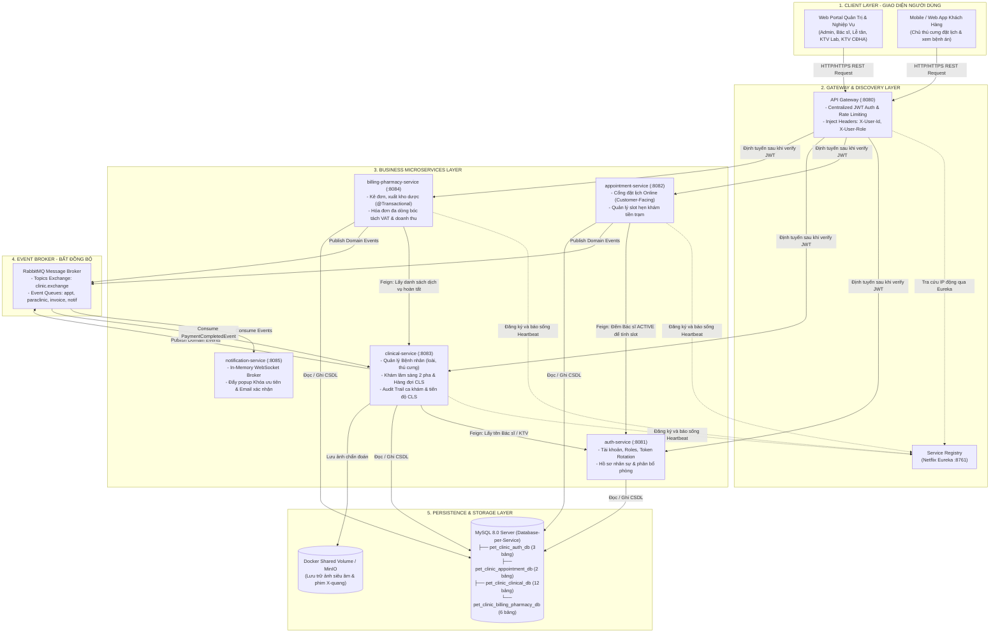
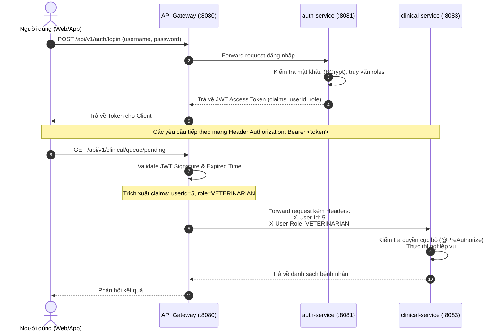

# TÀI LIỆU THIẾT KẾ KIẾN TRÚC HỆ THỐNG MICROSERVICES
## HỆ THỐNG QUẢN LÝ PHÒNG KHÁM THÚ Y (VET CLINIC MANAGEMENT SYSTEM)

> **Mục tiêu:** Cung cấp tài liệu thiết kế kiến trúc phân tán toàn diện cho đồ án tốt nghiệp, chuẩn hóa ranh giới dịch vụ (Bounded Contexts), cơ chế toàn vẹn dữ liệu (Inter-Service Data Integrity), luồng điều phối sự kiện bất đồng bộ và chiến lược giải quyết các bài toán phân tán thực tế.

---

## 1. Tổng quan Kiến trúc Tổng thể (High-Level Architecture)

Hệ thống được xây dựng theo mô hình **Microservices Architecture kết hợp Event-Driven Architecture (EDA)** trên nền tảng **Java 21** và **Spring Boot 3.3.x**, bao gồm các khối thành phần phân tầng chặt chẽ:

1. **Khách hàng (Client Layer):** Web Portal cho Quản trị viên/Bác sĩ/Lễ tân và Mobile/Web App cho Khách hàng/Chủ thú cưng.
2. **Cổng giao tiếp (API Gateway Layer):** Spring Cloud Gateway làm cổng vào duy nhất, chịu trách nhiệm định tuyến, xác thực tập trung và gắn thông tin người dùng vào HTTP Headers.
3. **Đăng ký & Phát hiện dịch vụ (Service Discovery):** Netflix Eureka Server quản lý động địa chỉ IP và cổng của tất cả các microservices.
4. **Phân hệ nghiệp vụ (Microservices Layer):** 4 nghiệp vụ cốt lõi chạy độc lập theo nguyên tắc *Database-per-Service* + 1 Notification Service giao tiếp bất đồng bộ qua WebSocket/Email.
5. **Hàng đợi thông điệp (Event Broker):** RabbitMQ điều phối các sự kiện thay đổi trạng thái (State Transitions) giữa các services mà không gây nghẽn mạng (Non-blocking).
6. **Lưu trữ dữ liệu (Data & Storage Layer):** CSDL MySQL 8.0 phân vùng thành 4 schemas logic độc lập và Docker Volume/MinIO lưu trữ tệp ảnh chẩn đoán cận lâm sàng.

---

## 2. Sơ đồ Kiến trúc Phân tầng (Architectural Diagram)



---

## 3. Phân rã Dịch vụ theo Bounded Context (Domain-Driven Design)

Hệ thống được chia thành **5 Microservices nghiệp vụ** + **2 Service hạ tầng cốt lõi** với tổng cộng **23 bảng CSDL**:

| Tên Microservice | Cổng | CSDL riêng biệt (MySQL) | Các bảng dữ liệu phụ trách | Trách nhiệm nghiệp vụ chính |
| :--- | :---: | :--- | :--- | :--- |
| **`service-registry`** | `8761` | *Không có* | *Không có* | Spring Cloud Netflix Eureka Server; quản lý đăng ký và phát hiện địa chỉ IP động của các service con. |
| **`api-gateway`** | `8080` | *Không có* | *Không có* | Điểm vào duy nhất (Single Point of Entry); kiểm tra chữ ký JWT, bóc tách `X-User-Id`, `X-User-Role` chuyển tiếp xuống downstream services; CORS, Rate Limiting. |
| **`auth-service`** | `8081` | `pet_clinic_auth_db` | `roles`, `users`, `refresh_tokens` (3 bảng) | Xác thực đăng nhập, mã hóa BCrypt, cấp phát JWT Access Token (TTL 30m) & Stateful Refresh Token (TTL 7d) có Token Rotation; quản lý phiên đăng nhập và hồ sơ nhân sự, phân bổ số phòng làm việc (`room_number`). |
| **`appointment-service`** | `8082` | `pet_clinic_appointment_db` | `appointments`, `appointment_status_histories` (2 bảng) | Cổng đặt lịch khám trực tuyến (Customer-Facing); tính toán sức chứa slot tiếp nhận động dựa trên số bác sĩ `ACTIVE`; lưu vết Audit Trail toàn bộ 5 bước chuyển trạng thái lịch hẹn. Độc lập 100% với phân hệ khám bệnh bên trong. |
| **`clinical-service`** | `8083` | `pet_clinic_clinical_db` | `species`, `pets`, `services`, `lab_test_items`, `lab_test_reference_ranges`, `pet_visits`, `pet_visit_status_histories`, `visit_service_details`, `visit_service_detail_histories`, `lab_test_results`, `imaging_results`, `imaging_attachments` (12 bảng) | Quản lý bệnh nhân thú cưng và loài; vận hành quy trình khám lâm sàng 2 pha; quản lý 2 hàng đợi độc lập (Lab & CĐHA); lưu vết lịch sử chuyển đổi trạng thái ca khám & tiến độ dịch vụ (Audit Trail); tự động kích hoạt Khóa ưu tiên. |
| **`billing-pharmacy-service`** | `8084` | `pet_clinic_billing_pharmacy_db` | `medicines`, `prescriptions`, `prescription_items`, `inventory_transactions`, `invoices`, `invoice_items` (6 bảng) | Kê đơn thuốc điện tử; quản lý tồn kho dược; lập hóa đơn viện phí đa dòng bóc tách doanh thu dịch vụ/thuốc và thuế VAT; xác nhận thanh toán và **thực hiện trừ kho an toàn trong 1 giao dịch `@Transactional` cục bộ**. |
| **`notification-service`** | `8085` | *In-Memory (Spring WebSocket Broker)* | *Không có* | Lắng nghe các sự kiện từ RabbitMQ để đẩy thông báo qua WebSocket (STOMP) realtime tới màn hình Bác sĩ/Lễ tân (chuông, popup, huy hiệu Khóa ưu tiên) và gửi Email xác nhận cho khách hàng. Không cần lưu trữ CSDL vật lý. |

---

## 4. Chiến lược Cơ sở dữ liệu (Database Strategy)

### 4.1. Mô hình "Một MySQL Server - Đa Cơ sở dữ liệu Logic"
- **Đặc điểm:** Vẫn tuân thủ nghiêm ngặt nguyên tắc **Database-per-Service** (mỗi service chỉ kết nối vào đúng CSDL của mình, tuyệt đối không được cross-query sang CSDL của service khác).
- **Tối ưu hóa tài nguyên:** Chỉ cần chạy **duy nhất 1 container MySQL 8.0** trong Docker Compose, bên trong khởi tạo 4 database logic:
  ```sql
  CREATE DATABASE pet_clinic_auth_db CHARACTER SET utf8mb4 COLLATE utf8mb4_unicode_ci;
  CREATE DATABASE pet_clinic_appointment_db CHARACTER SET utf8mb4 COLLATE utf8mb4_unicode_ci;
  CREATE DATABASE pet_clinic_clinical_db CHARACTER SET utf8mb4 COLLATE utf8mb4_unicode_ci;
  CREATE DATABASE pet_clinic_billing_pharmacy_db CHARACTER SET utf8mb4 COLLATE utf8mb4_unicode_ci;
  ```
- **Xử lý khóa ngoại liên Service (Cross-Service References):**
  - Trong Microservices, không còn khóa ngoại vật lý (`FOREIGN KEY`) giữa các bảng thuộc 2 service khác nhau.
  - Các khóa ngoại được thay thế bằng thuộc tính định danh thuần túy kiểu số nguyên `BIGINT` (ví dụ: bảng `pet_visits` lưu `doctor_id BIGINT`, `receptionist_id BIGINT` thay vì `REFERENCES users(id)`).
  - Tính hợp lệ của ID được kiểm tra thông qua OpenFeign API khi tạo mới.

---

## 5. Cơ chế Giao tiếp giữa các Dịch vụ (Inter-Service Communication)

### 5.1. Giao tiếp Đồng bộ (Synchronous via Spring Cloud OpenFeign)
Được sử dụng cho các tác vụ **truy vấn đọc dữ liệu (Read Queries)** hoặc kiểm tra điều kiện tiên quyết cần kết quả ngay lập tức:
- `appointment-service` $\rightarrow$ gọi `auth-service`: Lấy số lượng Bác sĩ `ACTIVE` để tính toán sức chứa slot hẹn (`MAX_APPOINTMENTS_PER_SLOT`).
- `clinical-service` $\rightarrow$ gọi `auth-service`: Lấy thông tin họ tên, phòng khám của Bác sĩ phụ trách.
- `billing-pharmacy-service` $\rightarrow$ gọi `clinical-service`: Lấy danh sách các dịch vụ kỹ thuật đã thực hiện (`COMPLETED`) để tổng hợp số tiền viện phí.

### 5.2. Giao tiếp Bất đồng bộ (Asynchronous Event-Driven via RabbitMQ)
Được sử dụng khi **trạng thái nghiệp vụ thay đổi (State Transitions)** nhằm đảm bảo tính phân tán lỏng (Loose Coupling), hệ thống không bị nghẽn (Non-blocking):

| Tên Sự kiện (Event) | Service Sản xuất (Producer) | Service Tiêu thụ (Consumer) | Hành động kích hoạt khi nhận Event |
| :--- | :--- | :--- | :--- |
| `AppointmentBookedEvent` | `appointment-service` | `notification-service` | Gửi Email / SMS thông báo mã đặt lịch cho Chủ nuôi. |
| `ParaclinicalResultsReadyEvent` | `clinical-service` | `notification-service` | Gửi WebSocket bật popup và huy hiệu Khóa ưu tiên trên màn hình Bác sĩ lâm sàng. |
| `VisitClosedToPaymentEvent` | `clinical-service` | `billing-pharmacy-service` | Tự động khởi tạo bản ghi Hóa đơn viện phí ở trạng thái `PENDING` sẵn sàng tại quầy Thu ngân. |
| `PaymentAndDispenseCompletedEvent` | `billing-pharmacy-service` | `clinical-service` | Cập nhật trạng thái đợt khám `pet_visits.status = 'COMPLETED'`. |
| `PaymentAndDispenseCompletedEvent` | `billing-pharmacy-service` | `notification-service` | In phiếu hướng dẫn dùng thuốc; gửi hóa đơn điện tử về ứng dụng khách hàng. |
| `MedicineLowStockAlertEvent` | `billing-pharmacy-service` | `notification-service` | Bắn cảnh báo đỏ lên màn hình Quản trị viên (Admin) khi tồn kho chạm ngưỡng tối thiểu. |

---

## 6. Chiến lược Xử lý Giao dịch Toàn vẹn (Transaction & Data Integrity)

### 6.1. Tại sao KHÔNG cần Saga phức tạp cho "Thanh toán & Trừ kho"?
- **Quyết định thiết kế xuất sắc:** Gộp Viện phí (`invoices`, `invoice_items`) và Đơn thuốc / Kho dược (`prescriptions`, `prescription_items`, `medicines`, `inventory_transactions`) vào chung một service `billing-pharmacy-service`.
- **Lợi ích cốt tử:**
  - Quy trình thanh toán tiền và trừ tồn kho thuốc được đặt chung trong một phương thức `@Transactional` của Spring Data JPA.
  - Nếu số lượng thuốc trong kho không đủ $\rightarrow$ Toàn bộ giao dịch thu tiền tự động Rollback ngay lập tức tại CSDL MySQL.
  - **Không bao giờ xảy ra tình trạng "Thu tiền rồi nhưng kho hết thuốc"** mà không cần phải viết hàng trăm dòng code bù trừ phức tạp (Compensating Transactions) của Saga Pattern.

### 6.2. Hoàn tất đợt khám đa Service (Eventual Consistency)
- Khi `billing-pharmacy-service` thanh toán thành công, nó gửi event `PaymentAndDispenseCompletedEvent` vào RabbitMQ.
- `clinical-service` lắng nghe event và cập nhật `pet_visits.status = 'COMPLETED'`.
- Trường hợp RabbitMQ bị trễ: `pet_visits` có thể ở trạng thái `WAITING_PAYMENT` thêm vài giây, nhưng không ảnh hưởng đến an toàn dữ liệu vì hóa đơn thực tế đã `PAID` và thuốc đã xuất kho.

---

## 7. Thiết kế Bảo mật & Xác thực (Security Architecture)



- **Stateless Token:** Sử dụng JSON Web Token (JWT) có chữ ký số HMAC-SHA256 bí mật (`jwt.secret`).
- **Phân tách trách nhiệm:** 
  - `auth-service` chịu trách nhiệm ký sinh token.
  - `api-gateway` xác thực tính hợp lệ của token trước khi forward.
  - Các service nghiệp vụ bên trong mạng nội bộ (`internal network`) tin tưởng thông tin người dùng được Gateway truyền qua Header `X-User-Id` và `X-User-Role`, không cần phải query lại bảng `users` ở mỗi request.

---

## 8. Cấu trúc Triển khai Docker Compose

Toàn bộ hệ thống được khởi chạy chỉ bằng 1 lệnh duy nhất:
```bash
docker compose up -d
```

### Cấu trúc các Container trong file `docker-compose.yml`:
1. `mysql-server`: CSDL MySQL 8.0 (chứa 4 database logic).
2. `rabbitmq-broker`: RabbitMQ Server 3.12 (kèm giao diện Management UI trên port `15672`).
3. `docker-volume`: Shared Volume gắn kết thư mục lưu trữ tệp ảnh (`/app/uploads/imaging/`).
4. `service-registry`: Eureka Server (port `8761`).
5. `api-gateway`: Spring Cloud Gateway (port `8080`).
6. `auth-service`: Port `8081`.
7. `appointment-service`: Port `8082`.
8. `clinical-service`: Port `8083`.
9. `billing-pharmacy-service`: Port `8084`.
10. `notification-service`: Port `8085`.

---

## 9. Bộ Câu hỏi & Trả lời chuẩn bị Bảo vệ trước Hội đồng chấm Đồ án (Defense Q&A)

| Câu hỏi từ Hội đồng | Câu trả lời chuẩn mực & Tự tin |
| :--- | :--- |
| **Hội đồng hỏi:** *Tại sao hệ thống phòng khám quy mô vừa lại chọn Microservices thay vì Monolith? Có bị over-engineering không?* | **Sinh viên trả lời:** "Dạ thưa Thầy/Cô, việc áp dụng Microservices trong đồ án nhằm mục đích: (1) Nghiên cứu và làm chủ các kỹ thuật phân tán chuẩn công nghiệp như API Gateway, Service Registry và Event-Driven Messaging; (2) Phân định ranh giới nghiệp vụ độc lập: phân hệ Khách hàng/Đặt lịch có lưu lượng truy cập cao có thể co giãn (scale-out) độc lập mà không ảnh hưởng tới phân hệ Khám lâm sàng nội bộ; (3) Em đã áp dụng tư duy thiết kế thực dụng (Pragmatic DDD) bằng cách gộp các phân hệ phụ thuộc chặt chẽ như Viện phí và Dược thành một service để tránh rủi ro phân tán dữ liệu, đảm bảo hệ thống vừa hiện đại vừa vững chắc." |
| **Hội đồng hỏi:** *Vì sao lại chuyển Hồ sơ thú cưng (`pets`, `species`) sang `clinical-service` thay vì để ở `appointment-service`? Có gây nghẽn mạng không?* | **Sinh viên trả lời:** "Dạ thưa Thầy/Cô, ban đầu em để `pets` bên `appointment-service`. Nhưng khi phân tích sâu về hiệu năng và luồng công việc của phòng khám, Bác sĩ khám lâm sàng liên tục đọc và cập nhật bệnh án thú cưng ở tần suất rất cao. Nếu để bên `appointment-service`, mỗi ca khám Bác sĩ phải gọi mạng (network I/O) sang bên kia, rất dễ gây nghẽn khi cổng đặt lịch bên ngoài bị quá tải. Do đó, em đã chuyển `species` và `pets` về `clinical-service` để tạo thành phân hệ 'Quản lý Bệnh nhân & Lâm sàng'. Khi đó, Bác sĩ đọc hồ sơ bệnh án qua truy vấn nội bộ siêu nhanh (< 2ms), tính tự chủ cực cao. Còn `appointment-service` đóng vai trò là Cổng Booking bên ngoài thuần túy, lỡ cổng này nghẽn thì phòng khám bên trong vẫn cấp cứu và khám bệnh bình thường." |
| **Hội đồng hỏi:** *CSDL phân biệt dữ liệu cố định (Master Data) và biến động (Transactional) thế nào? Tại sao lại cần thêm bảng lưu vết lịch sử (Audit Trail)?* | **Sinh viên trả lời:** "Dạ, CSDL của em phân tầng rất rõ ràng: (1) Nhóm Danh mục ít đổi (Master Data) gồm bảng `roles`, `species`, `services`, `lab_test_items`, `medicines`. (2) Nhóm Biến động theo giao dịch (Transactional) gồm `appointments`, `pet_visits`, `visit_service_details`, `prescriptions`, `invoices`. Nhóm này đều có cơ chế **Snapshot Schema** (lưu cố định đơn giá, khoảng tham chiếu sinh lý tại thời điểm tạo để lịch sử không bị sai lệch khi danh mục đổi giá sau này). (3) Nhóm Lưu vết quá trình (Audit Trail): Em đã bổ sung các bảng chuyên dụng gồm `appointment_status_histories` (audit 5 bước chuyển trạng thái lịch hẹn), `pet_visit_status_histories` (audit 7 bước chuyển trạng thái ca khám), `visit_service_detail_histories` (audit tiến độ chỉ định, tạm hoãn, gọi lại, hủy dịch vụ), kết hợp với `inventory_transactions` bên kho dược để phục vụ kiểm toán và tra soát y tế toàn diện." |
| **Hội đồng hỏi:** *Vì sao Invoice lại nằm bên service kho dược? Làm sao bóc tách thuế VAT và doanh thu tiền khám, tiền thuốc khi trong CSDL quan hệ cần sự liên kết chặt chẽ?* | **Sinh viên trả lời:** "Dạ thưa Thầy/Cô, việc để Hóa đơn chung với Kho dược là để tận dụng giao dịch ACID cục bộ (`@Transactional`): Khách thanh toán tại quầy xong là kho dược tự động trừ ngay lập tức, triệt tiêu rủi ro thu tiền nhưng hết thuốc. Để CSDL quan hệ chặt chẽ và hạch toán minh bạch: (1) Bảng `invoices` có khóa ngoại nội bộ `prescription_id` trỏ thẳng sang `prescriptions(id)`. (2) Em đã tách chi tiết hóa đơn ra bảng **`invoice_items`** (quan hệ 1-N với `invoices`). Mỗi dòng có `item_type` phân loại rõ `SERVICE` hay `MEDICINE`, lưu riêng thuế suất VAT (`vat_rate`) và tiền thuế (`vat_amount`). Nhờ vậy, kế toán bóc tách được chính xác từng đồng doanh thu dịch vụ khám, doanh thu thuốc và thuế GTGT theo đúng chuẩn kế toán tài chính." |
| **Hội đồng hỏi:** *Các service giao tiếp với nhau như thế nào? Khi nào dùng OpenFeign, khi nào dùng RabbitMQ?* | **Sinh viên trả lời:** "Dạ, em phân định ranh giới rất rõ ràng: Đối với các thao tác truy vấn đọc dữ liệu cần phản hồi tức thì (ví dụ `appointment-service` cần đếm số bác sĩ rảnh để tính slot), em dùng **Spring Cloud OpenFeign (đồng bộ)** qua Eureka. Đối với các hành vi thay đổi trạng thái nghiệp vụ (ví dụ có kết quả xét nghiệm, chốt thanh toán, cảnh báo kho), em dùng **RabbitMQ (bất đồng bộ)** để phát sự kiện, giúp dịch vụ gửi đi không bị nghẽn (non-blocking) và các dịch vụ khác (như Notification) có thể tiêu thụ độc lập." |
| **Hội đồng hỏi:** *Cơ chế xác thực (Authentication) và phân quyền (Authorization) hoạt động ra sao?* | **Sinh viên trả lời:** "Dạ, em áp dụng mô hình bảo mật chuẩn OAuth2/JWT phân tầng: Khách hàng gửi thông tin đăng nhập qua Gateway tới `auth-service` để nhận JWT Token. Tại các request tiếp theo, API Gateway đóng vai trò 'người gác cổng' thực hiện xác thực chữ ký JWT, sau đó bóc tách `User-Id` và `Role` truyền xuống các downstream services qua HTTP Headers. Các service nghiệp vụ bên trong áp dụng `@PreAuthorize` để phân quyền cụ thể theo 6 vai trò của hệ thống." |
