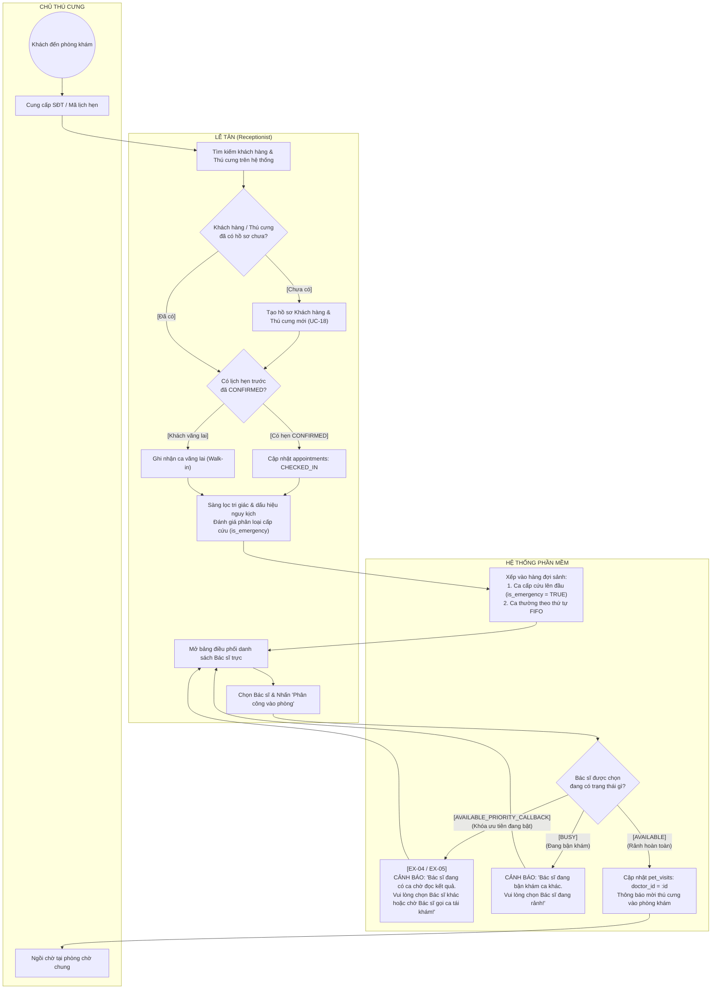
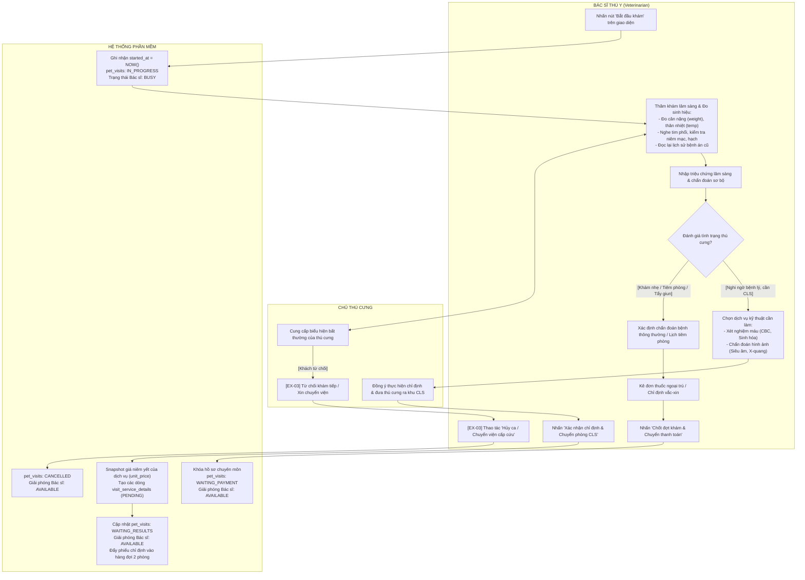
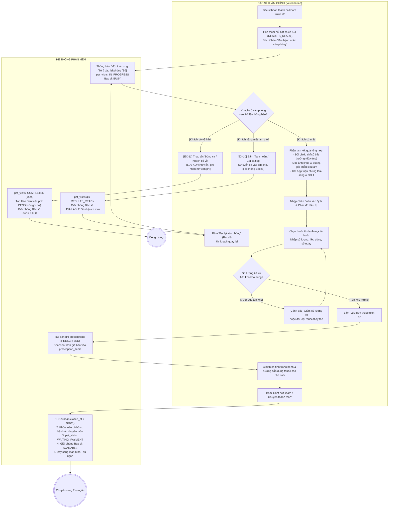
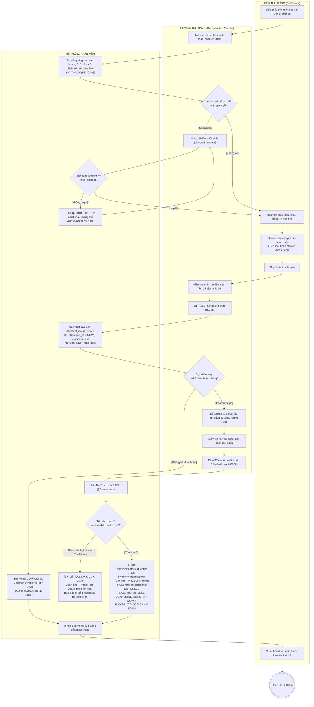

# THIẾT KẾ SƠ ĐỒ HOẠT ĐỘNG (UML ACTIVITY DIAGRAMS)
## HỆ THỐNG QUẢN LÝ PHÒNG KHÁM THÚ Y

> **Tài liệu chuẩn UML 2.5 / RUP phục vụ Thuyết minh & Bảo vệ Đồ án tốt nghiệp**  
> **Mục tiêu:** Mô tả chi tiết các luồng công việc (Workflows), sự phân làn trách nhiệm đa tác nhân (Swimlanes / Partitions), các điểm phân tách và đồng bộ song song (Fork & Join Nodes), các điều kiện rẽ nhánh (Decision Nodes) và cơ chế xử lý ngoại lệ trong hệ thống quản lý phòng khám thú y ngoại trú.

---

## MỤC LỤC TỔNG QUAN

1. [Quy chuẩn Ký hiệu & Nguyên tắc Thiết kế UML Activity Diagram](#1-quy-chuẩn-ký-hiệu--nguyên-tắc-thiết-kế-uml-activity-diagram)
2. [AD-01: Chu trình Khám chữa bệnh Ngoại trú Hai pha Tổng thể (End-to-End Clinical Cycle)](#2-ad-01-chu-trình-khám-chữa-bệnh-ngoại-trú-hai-pha-tổng-thể)
3. [AD-02: Quy trình Tiếp đón, Điều phối Hàng đợi & Khóa Ưu tiên Bác sĩ (Patient Reception & Priority Lock)](#3-ad-02-quy-trình-tiếp-đón-điều-phối-hàng-đợi--khóa-ưu-tiên-bác-sĩ)
4. [AD-03: Quy trình Khám Lâm sàng Sơ bộ & Chỉ định Dịch vụ Kỹ thuật Giai đoạn 1 (Initial Assessment & Ordering)](#4-ad-03-quy-trình-khám-lâm-sàng-sơ-bộ--chỉ-định-dịch-vụ-kỹ-thuật-giai-đoạn-1)
5. [AD-04: Quy trình Thực hiện Cận lâm sàng Song song & Xử lý Ngoại lệ Hàng đợi (Parallel Paraclinical Execution)](#5-ad-04-quy-trình-thực-hiện-cận-lâm-sàng-song-song--xử-lý-ngoại-lệ-hàng-đợi)
6. [AD-05: Quy trình Hội chẩn Kết quả, Chẩn đoán Xác định & Kê đơn Giai đoạn 2 (Post-diagnostic Consultation & Rx)](#6-ad-05-quy-trình-hội-chẩn-kết-quả-chẩn-đoán-xác-định--kê-đơn-giai-đoạn-2)
7. [AD-06: Quy trình Lập Hóa đơn, Thu ngân Viện phí & Xuất kho Thuốc An toàn (Billing, Dispensing & Stock)](#7-ad-06-quy-trình-lập-hóa-đơn-thu-ngân-viện-phí--xuất-kho-thuốc-an-toàn)
8. [Ma trận Truy vết Nghiệp vụ Tổng hợp (Traceability Matrix)](#8-ma-trận-truy-vết-nghiệp-vụ-tổng-hợp-traceability-matrix)

---

## 1. QUY CHUẨN KÝ HIỆU & NGUYÊN TẮC THIẾT KẾ UML ACTIVITY DIAGRAM

### 1.1. Bảng tra cứu ký hiệu chuẩn UML 2.5 áp dụng trong tài liệu

| Thành phần UML 2.5 | Ký hiệu đồ họa chuẩn | Biểu diễn trên Mermaid | Ý nghĩa nghiệp vụ |
| :--- | :---: | :---: | :--- |
| **Initial Node** | Hình tròn đặc đen `●` | `((Bắt đầu))` | Điểm khởi phát luồng thực thi nghiệp vụ. |
| **Activity Final Node** | Hình tròn có viền ngoài `◉` | `(((Kết thúc)))` | Điểm kết thúc toàn bộ quy trình công việc. |
| **Flow Final Node** | Hình tròn có dấu X `⊗` | `((x))` | Kết thúc một nhánh rẽ phụ mà không hủy toàn bộ luồng. |
| **Action Node** | Hình chữ nhật bo góc | `["Tên hành động"]` | Thao tác đơn vị do một vai trò hoặc hệ thống thực hiện. |
| **Decision / Merge Node** | Hình thoi `<>` | `{"Điều kiện kiểm tra?"}` | Điểm rẽ nhánh có điều kiện canh `[Guard]` hoặc gộp các nhánh rẽ. |
| **Fork Node** | Thanh ngang/dọc đậm | `== Fork ==` | Phân tách một luồng thực thi thành 2 hay nhiều luồng song song độc lập. |
| **Join Node** | Thanh ngang/dọc đậm | `== Join ==` | Điểm hội tụ, chờ tất cả các luồng song song hoàn tất mới đi tiếp. |
| **Swimlane / Partition** | Cột / Hàng phân cách | `subgraph VaiTrò` | Ranh giới trách nhiệm của từng Actor hoặc Hệ thống. |
| **Object Node / Pin** | Hình chữ nhật vuông | `[Entity: State]` | Trạng thái của thực thể CSDL tại một thời điểm then chốt. |

### 1.2. Danh sách 6 Phân làn trách nhiệm (Swimlanes / Partitions) chuẩn

Hệ thống được thiết kế theo đúng mô hình phân quyền 6 vai trò của CSDL (`roles`) và tác nhân tự động:
1. **Chủ thú cưng (Pet Owner):** Người mang thú cưng đến, cung cấp triệu chứng, đưa thú cưng vào các phòng máy, thanh toán viện phí và nhận thuốc.
2. **Lễ tân / Thu ngân (Receptionist / Cashier):** Nhân viên tiếp đón ban đầu tại quầy, kiểm tra lịch hẹn, phân công bác sĩ, thu ngân viện phí và trực tiếp lấy thuốc từ tủ thuốc theo đơn để cấp phát.
3. **Bác sĩ khám chính (`VETERINARIAN`):** Bác sĩ phụ trách ca khám lâm sàng tại phòng khám cố định, thực hiện khám lâm sàng sơ bộ (GĐ 1), chỉ định cận lâm sàng, đọc kết quả tổng hợp (GĐ 2), chẩn đoán xác định và kê đơn thuốc.
4. **Kỹ thuật viên Xét nghiệm (`LAB_TECHNICIAN`):** Nhân viên phụ trách phòng Xét nghiệm, lấy mẫu máu/bệnh phẩm, nạp máy phân tích tự động, đối soát tham chiếu loài và xác nhận kết quả xét nghiệm.
5. **Kỹ thuật viên / Bác sĩ CĐHA (`IMAGING_TECHNICIAN`):** Nhân viên phụ trách phòng Chẩn đoán hình ảnh, điều khiển máy siêu âm, chụp X-quang, tải ảnh lên hệ thống và đưa ra kết luận hình thái học.
6. **Hệ thống phần mềm (Automated System):** Các dịch vụ xử lý ngầm: tính toán trạng thái bác sĩ thời gian thực, điều phối hàng đợi ưu tiên, thông báo gọi số tự động, kiểm soát Khóa ưu tiên (Priority Lock) và giao dịch CSDL an toàn (`@Transactional`).

---

## 2. AD-01: CHU TRÌNH KHÁM CHỮA BỆNH NGOẠI TRÚ HAI PHA TỔNG THỂ

### 2.1. Ý nghĩa & Bối cảnh nghiệp vụ
Đây là **sơ đồ hoạt động cốt lõi và phức tạp nhất** của phần mềm, mô tả trọn vẹn chu trình một thú cưng từ khi bước chân vào phòng khám cho đến khi ra về. Quy trình này phản ánh mô hình **Chu kỳ Y tế Bất đồng bộ (Asynchronous Clinical Cycle)**: giải phóng bác sĩ khi bệnh nhân đi làm cận lâm sàng và sử dụng cơ chế Khóa ưu tiên (Priority Lock) khi có kết quả trả về.

### 2.2. Sơ đồ Hoạt động Swimlane (Mermaid Diagram)

```mermaid
flowchart TD
    %% Khởi tạo các Swimlanes
    subgraph LANE_CLIENT["CHỦ THÚ CƯNG (Pet Owner)"]
        CL_START((Bắt đầu))
        CL_BRING["Đưa thú cưng đến sảnh phòng khám"]
        CL_WAIT_1["Chờ tại sảnh tiếp đón"]
        CL_ENTER_CLINIC["Đưa thú cưng vào phòng Bác sĩ"]
        CL_GO_PARACLINIC["Đưa thú cưng sang khu Cận lâm sàng"]
        CL_WAIT_2["Ngồi chờ kết quả tại sảnh"]
        CL_RE_ENTER["Đưa thú cưng vào lại phòng Bác sĩ (GĐ 2)"]
        CL_PAY["Thanh toán viện phí tại quầy thu ngân"]
        CL_RECEIVE_MED["Nhận thuốc & nghe hướng dẫn cách dùng"]
        CL_END(((Kết thúc: Thú cưng ra về)))
    end

    subgraph LANE_RECEPTION["LỄ TÂN / THU NGÂN (Receptionist / Cashier)"]
        REC_CHECKIN["Tiếp nhận, sàng lọc cấp cứu ban đầu\n(Tạo Pet Visit)"]
        REC_ASSIGN["Điều phối phân công Bác sĩ vào phòng khám"]
        REC_BILLING["Mở hóa đơn tạm tính, xác nhận thanh toán viện phí"]
        REC_DISPENSE["Lấy thuốc từ tủ thuốc theo đơn,\nkiểm tra hạn dùng & dán nhãn"]
    end

    subgraph LANE_DOCTOR["BÁC SĨ KHÁM CHÍNH (Veterinarian)"]
        DOC_START_1["Bấm 'Bắt đầu khám' (GĐ 1)\nKhám thực thể, tim phổi, da niêm"]
        DOC_DECIDE{Cần chỉ định\nCận lâm sàng?}
        DOC_ORDER["Chọn dịch vụ Lab / CĐHA,\nbấm 'Chỉ định & Gửi phòng CLS'"]
        DOC_FAST_RX["Chẩn đoán xác định,\nkê đơn ngoại trú / tiêm vaccine ngay"]
        DOC_CALL_G2["Bấm 'Mời vào phòng' (GĐ 2)\nĐón lại ca tái khám đã có KQ"]
        DOC_CONSULT["Phân tích chỉ số máu, ảnh X-quang,\nchẩn đoán xác định & kê đơn thuốc"]
        DOC_CLOSE["Bấm 'Chốt đợt khám & Khóa bệnh án'\n(Chuyển sang Chờ thanh toán)"]
    end

    subgraph LANE_LAB["KỸ THUẬT VIÊN LAB (Lab Technician)"]
        LAB_QUEUE["Tiếp nhận chỉ định vào hàng đợi Lab"]
        LAB_EXEC["Lấy ven máu, nạp máy phân tích tự động"]
        LAB_INPUT["Nhập kết quả, đối chiếu tham chiếu loài,\nbấm Xác nhận hoàn tất"]
    end

    subgraph LANE_IMAGING["KTV / BÁC SĨ CĐHA (Imaging Technician / Doctor)"]
        IMG_QUEUE["Tiếp nhận chỉ định vào hàng đợi CĐHA"]
        IMG_EXEC["Đưa thú cưng lên bàn chụp X-quang / Siêu âm"]
        IMG_INPUT["Tải ảnh DICOM/JPG, nhập kết luận hình thái,\nbấm Xác nhận hoàn tất"]
    end

    subgraph LANE_SYSTEM["HỆ THỐNG PHẦN MỀM (Automated System)"]
        SYS_ENQUEUE["Xếp vào Hàng đợi chung sảnh\n(pet_visits: WAITING)"]
        SYS_BUSY_1["Cập nhật Bác sĩ: BUSY\n(pet_visits: IN_PROGRESS)"]
        SYS_FREE_DOC["pet_visits: WAITING_RESULTS\nGiải phóng Bác sĩ: AVAILABLE"]
        SYS_FORK_CLS== FORK: Phân tách 2 hàng đợi song song ==
        SYS_JOIN_CLS== JOIN: Chờ đủ cả 2 phòng hoàn thành ==
        SYS_READY["pet_visits: RESULTS_READY\nKích hoạt KHÓA ƯU TIÊN cho Bác sĩ"]
        SYS_BUSY_2["Cập nhật Bác sĩ: BUSY (GĐ 2)\nMở bệnh án tổng hợp"]
        SYS_LOCK_PAY["Khóa bệnh án chuyên môn\npet_visits: WAITING_PAYMENT"]
        SYS_PAID["Hóa đơn: PAID\nMở khóa quyền xuất thuốc"]
        SYS_TX_DISPENSE["@Transactional: Trừ kho thuốc,\nghi nhật ký biến động kho\npet_visits: COMPLETED"]
    end

    %% Luồng liên kết các bước
    CL_START --> CL_BRING --> REC_CHECKIN --> SYS_ENQUEUE
    SYS_ENQUEUE --> REC_ASSIGN --> CL_WAIT_1
    REC_ASSIGN --> DOC_START_1
    DOC_START_1 --> SYS_BUSY_1 --> CL_ENTER_CLINIC
    CL_ENTER_CLINIC --> DOC_DECIDE

    %% Rẽ nhánh 1: Khám nhẹ / Tiêm phòng không cần CLS
    DOC_DECIDE -- "[Không cần CLS - Ca thông thường]" --> DOC_FAST_RX
    DOC_FAST_RX --> DOC_CLOSE

    %% Rẽ nhánh 2: Cần Cận lâm sàng
    DOC_DECIDE -- "[Cần xét nghiệm / chụp ảnh]" --> DOC_ORDER
    DOC_ORDER --> SYS_FREE_DOC
    SYS_FREE_DOC --> CL_GO_PARACLINIC
    SYS_FREE_DOC --> SYS_FORK_CLS

    %% Chạy song song 2 phòng kỹ thuật
    SYS_FORK_CLS --> LAB_QUEUE --> LAB_EXEC --> LAB_INPUT --> SYS_JOIN_CLS
    SYS_FORK_CLS --> IMG_QUEUE --> IMG_EXEC --> IMG_INPUT --> SYS_JOIN_CLS

    %% Hội tụ sau khi có đủ kết quả
    SYS_JOIN_CLS --> SYS_READY --> CL_WAIT_2
    SYS_READY --> DOC_CALL_G2
    DOC_CALL_G2 --> SYS_BUSY_2 --> CL_RE_ENTER
    CL_RE_ENTER --> DOC_CONSULT --> DOC_CLOSE

    %% Chốt ca và chuyển sang Thanh toán & Lấy thuốc
    DOC_CLOSE --> SYS_LOCK_PAY --> REC_BILLING
    REC_BILLING --> CL_PAY --> SYS_PAID
    SYS_PAID --> REC_DISPENSE
    REC_DISPENSE --> SYS_TX_DISPENSE --> CL_RECEIVE_MED --> CL_END
```

---

## 3. AD-02: TIẾP ĐÓN, ĐIỀU PHỐI HÀNG ĐỢI & CƠ CHẾ KHÓA ƯU TIÊN BÁC SĨ

### 3.1. Ý nghĩa & Bối cảnh nghiệp vụ
Biểu diễn quy trình tiếp đón tại sảnh (UC-18, UC-19, UC-20, UC-21), xử lý hai nguồn khách hàng (Khách đặt lịch trước vs Khách vãng lai Walk-in) và cơ chế tự động bảo vệ thời gian của Bác sĩ thông qua **Khóa ưu tiên (Priority Lock)**.

### 3.2. Sơ đồ Hoạt động Phân làn



---

## 4. AD-03: KHÁM LÂM SÀNG SƠ BỘ & CHỈ ĐỊNH DỊCH VỤ KỸ THUẬT GIAI ĐOẠN 1

### 4.1. Ý nghĩa & Bối cảnh nghiệp vụ
Mô tả quy trình nghiệp vụ chuyên môn trong phòng khám tại Giai đoạn 1 (UC-22 & UC-23). Bác sĩ thăm khám thực thể, đưa ra chẩn đoán sơ bộ và quyết định rẽ nhánh: ca khám nhẹ thì kê đơn chốt luôn; ca phức tạp thì chỉ định cận lâm sàng và trả bác sĩ về trạng thái sẵn sàng đón ca khác.

### 4.2. Sơ đồ Hoạt động Phân làn



---

## 5. AD-04: THỰC HIỆN CẬN LÂM SÀNG SONG SONG & XỬ LÝ NGOẠI LỆ HÀNG ĐỢI

### 5.1. Ý nghĩa & Bối cảnh nghiệp vụ
Mô tả tiến trình thực hiện song song tại 2 phòng độc lập: **Phòng Xét nghiệm (Lab)** và **Phòng Chẩn đoán hình ảnh (CĐHA)** (UC-25 & UC-26). Sơ đồ đặc tả cơ chế phân tách luồng (Fork), hội tụ luồng (Join) và xử lý toàn diện các ngoại lệ: Khách vắng mặt sau 3 lần gọi (EX-06), Khách quay lại báo có mặt (EX-07), Khách xin hủy 1 dịch vụ (EX-08).

### 5.2. Sơ đồ Hoạt động Phân làn

```mermaid
flowchart TD
    FORK_START((Bác sĩ gửi chỉ định)) --> SYS_FORK== FORK: Phân luồng sang 2 phòng chuyên môn ==

    %% PHÂN LÀN LAB
    subgraph LANE_LAB["PHÒNG XÉT NGHIỆM (Lab Room)"]
        L_QUEUE["Hàng đợi Xét nghiệm (status: PENDING)"]
        L_CALL["KTV bấm gọi số vào phòng lấy mẫu"]
        L_DECIDE_PRESENT{Khách có mặt\nsau 3 lần gọi?}
        L_POSTPONE["[EX-06] Bấm 'Tạm hoãn do vắng mặt'\n(Chuyển ca sang tab Hoãn, gọi ca tiếp theo)"]
        L_NEXT_IN_LINE["[EX-07] Khách quay lại bấm 'Có mặt'\n(Ghim vị trí Ưu tiên kế tiếp)"]
        L_DRAW_BLOOD["Thú cưng vào phòng: Lấy ven máu & nạp máy"]
        L_MACHINE["Máy huyết học/sinh hóa phân tích tự động"]
        L_INPUT_DATA["Nhập chỉ số đo đạc vào hệ thống"]
        L_CANCEL_ONE["[EX-08] Khách xin hủy xét nghiệm máu"]
    end

    %% PHÂN LÀN CĐHA
    subgraph LANE_IMAGING["PHÒNG CHẨN ĐOÁN HÌNH ẢNH (Imaging Room)"]
        I_QUEUE["Hàng đợi CĐHA (status: PENDING)"]
        I_CALL["KTV/Bác sĩ CĐHA gọi số vào phòng máy"]
        I_DECIDE_PRESENT{Khách có mặt\nsau 3 lần gọi?}
        I_POSTPONE["[EX-06] Bấm 'Tạm hoãn do vắng mặt'\n(Chuyển ca sang tab Hoãn, gọi ca tiếp theo)"]
        I_NEXT_IN_LINE["[EX-07] Khách quay lại bấm 'Có mặt'\n(Ghim vị trí Ưu tiên kế tiếp)"]
        I_CAPTURE["Thú cưng vào phòng: Siêu âm bụng / Chụp X-quang"]
        I_UPLOAD["Tải tệp ảnh chụp lên hệ thống & Nhập kết luận"]
        I_CANCEL_ONE["[EX-08] Khách xin hủy siêu âm/X-quang"]
    end

    %% PHÂN LÀN HỆ THỐNG
    subgraph LANE_SYSTEM["HỆ THỐNG PHẦN MỀM"]
        S_CHECK_LAB_REF["Tự động đối chiếu khoảng tham chiếu loài (Chó/Mèo)\nCảnh báo màu: Vàng (Low) - Xanh (Normal) - Đỏ (High)"]
        S_SAVE_LAB["Lưu lab_test_results\nvisit_service_details: COMPLETED"]
        S_SAVE_IMG["Lưu imaging_results & imaging_attachments\nvisit_service_details: COMPLETED"]
        S_CANCEL_SVC["[EX-08] visit_service_details: CANCELLED\n(Hóa đơn viện phí tự động loại trừ dịch vụ này)"]
        SYS_JOIN== JOIN: Kiểm tra tất cả dịch vụ của ca khám ==
        S_EVAL_ALL{Còn dịch vụ nào\nở PENDING hoặc IN_PROGRESS?}
        S_TRIGGER_READY["pet_visits: RESULTS_READY\nKích hoạt KHÓA ƯU TIÊN cho Bác sĩ khám chính\nPhát thông báo nhẹ (Notification Badge) trên màn hình Bác sĩ"]
    end

    %% Luồng Lab
    SYS_FORK --> L_QUEUE --> L_CALL --> L_DECIDE_PRESENT
    L_DECIDE_PRESENT -- "[Vắng mặt]" --> L_POSTPONE --> L_NEXT_IN_LINE --> L_DRAW_BLOOD
    L_DECIDE_PRESENT -- "[Có mặt]" --> L_DRAW_BLOOD
    L_DRAW_BLOOD --> L_MACHINE --> L_INPUT_DATA --> S_CHECK_LAB_REF --> S_SAVE_LAB --> SYS_JOIN
    L_QUEUE -- "[Khách xin hủy]" --> L_CANCEL_ONE --> S_CANCEL_SVC --> SYS_JOIN

    %% Luồng CĐHA
    SYS_FORK --> I_QUEUE --> I_CALL --> I_DECIDE_PRESENT
    I_DECIDE_PRESENT -- "[Vắng mặt]" --> I_POSTPONE --> I_NEXT_IN_LINE --> I_CAPTURE
    I_DECIDE_PRESENT -- "[Có mặt]" --> I_CAPTURE
    I_CAPTURE --> I_UPLOAD --> S_SAVE_IMG --> SYS_JOIN
    I_QUEUE -- "[Khách xin hủy]" --> I_CANCEL_ONE --> S_CANCEL_SVC --> SYS_JOIN

    %% Luồng hội tụ
    SYS_JOIN --> S_EVAL_ALL
    S_EVAL_ALL -- "[Vẫn còn dịch vụ chưa xong]" --> S_WAIT((Tiếp tục chờ phòng còn lại))
    S_EVAL_ALL -- "[Tất cả đã xong hoặc hủy]" --> S_TRIGGER_READY --> READY_END(((Chuyển sang GĐ 2)))
```

---

## 6. AD-05: HỘI CHẨN KẾT QUẢ, CHẨN ĐOÁN XÁC ĐỊNH & KÊ ĐƠN GIAI ĐOẠN 2

### 6.1. Ý nghĩa & Bối cảnh nghiệp vụ
Mô tả quy trình Bác sĩ đón lại bệnh nhân sau khi có kết quả cận lâm sàng (UC-30, UC-31, UC-33). Bác sĩ hội chẩn toàn diện, chẩn đoán xác định, kê đơn thuốc điện tử (kiểm tra tồn kho khả dụng) và thực hiện khóa bệnh án 1 chiều không thể đảo ngược.

### 6.2. Sơ đồ Hoạt động Phân làn



---

## 7. AD-06: QUY TRÌNH LẬP HÓA ĐƠN, THU NGÂN VIỆN PHÍ & XUẤT THUỐC TRỪ KHO AN TOÀN

### 7.1. Ý nghĩa & Bối cảnh nghiệp vụ
Mô tả quy trình xử lý tài chính và cấp phát dược phẩm tại quầy (UC-34, UC-35, UC-36). Nhân viên **Lễ tân / Thu ngân** trực tiếp thu tiền và lấy thuốc từ tủ thuốc theo đơn. Thao tác xuất thuốc được bảo vệ bằng giao dịch CSDL an toàn (`@Transactional`) để ngăn ngừa lỗi bất đồng bộ tồn kho (Race Condition).

### 7.2. Sơ đồ Hoạt động Phân làn



---

## 8. MA TRẬN TRUY VẾT NGHIỆP VỤ TỔNG HỢP (TRACEABILITY MATRIX)

Ma trận dưới đây chứng minh tính liên kết khép kín và nhất quán 100% giữa các Sơ đồ Hoạt động (Activity Diagrams) với Ca sử dụng (Use Cases), Sơ đồ Trạng thái (State Machines) và Danh mục Ngoại lệ hệ thống (Exceptions):

| Mã Activity Diagram | Tên Quy trình nghiệp vụ | Use Case liên quan | State Machine & Thực thể CSDL | Mã Ngoại lệ xử lý |
| :---: | :--- | :---: | :---: | :---: |
| **AD-01** | Chu trình Khám Ngoại trú Hai pha Tổng thể | UC-19, 22, 23, 25, 26, 30, 31, 34, 35, 36 | `pet_visits` (SM-01)<br>`doctor_serving_status` (SM-02) | EX-03, EX-06, EX-08, EX-10, EX-15 |
| **AD-02** | Tiếp đón, Điều phối & Khóa Ưu tiên Bác sĩ | UC-14, 16, 17, 18, 19, 20, 21 | `appointments` (SM-04)<br>`doctor_serving_status` (SM-02) | EX-01, EX-02, EX-04, EX-05 |
| **AD-03** | Khám Lâm sàng Sơ bộ & Chỉ định CLS Giai đoạn 1 | UC-22, UC-23 | `pet_visits` (GĐ 1)<br>`visit_service_details` (SM-03) | EX-03, EX-12 |
| **AD-04** | Thực hiện Cận lâm sàng Song song & Hàng đợi | UC-25, UC-26 | `visit_service_details` (SM-03)<br>`pet_visits` (`WAITING_RESULTS` $\rightarrow$ `RESULTS_READY`) | EX-06, EX-07, EX-08, EX-09 |
| **AD-05** | Hội chẩn Kết quả, Chẩn đoán & Kê đơn Giai đoạn 2 | UC-30, UC-31, UC-33 | `pet_visits` (GĐ 2)<br>`prescriptions` (SM-06) | EX-10, EX-11, EX-13 |
| **AD-06** | Lập Hóa đơn, Thu ngân & Xuất kho Thuốc An toàn | UC-34, UC-35, UC-36 | `invoices` (SM-05)<br>`prescriptions` (SM-06)<br>`inventory_transactions` | EX-14, EX-15, EX-16 |
