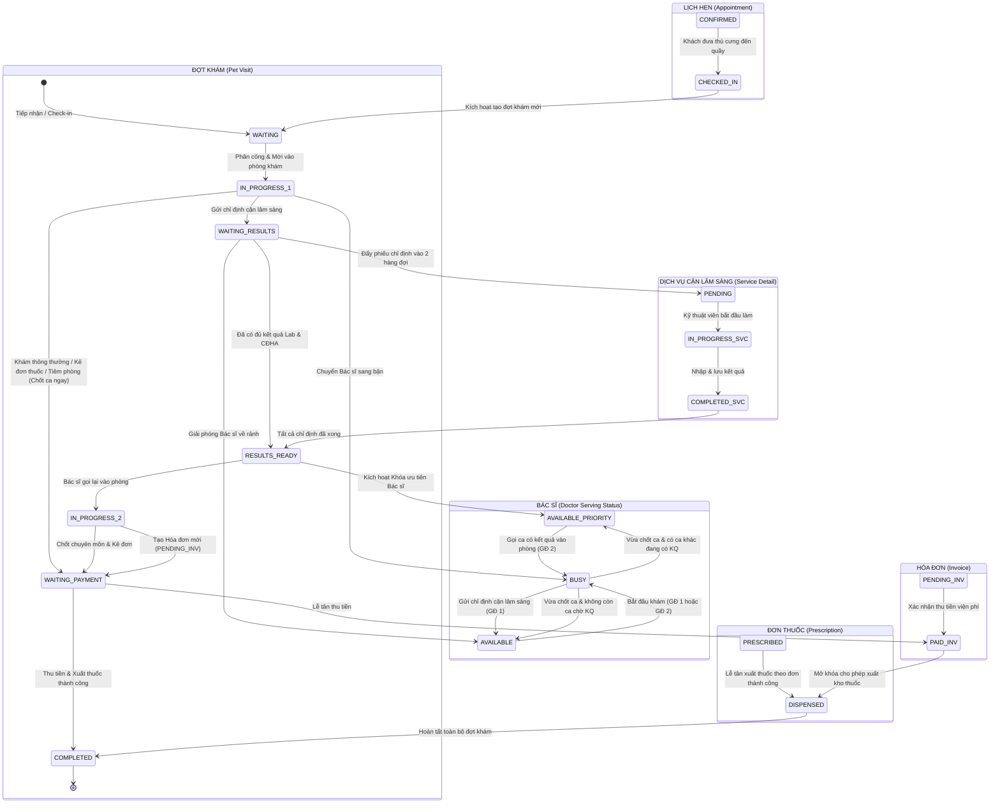
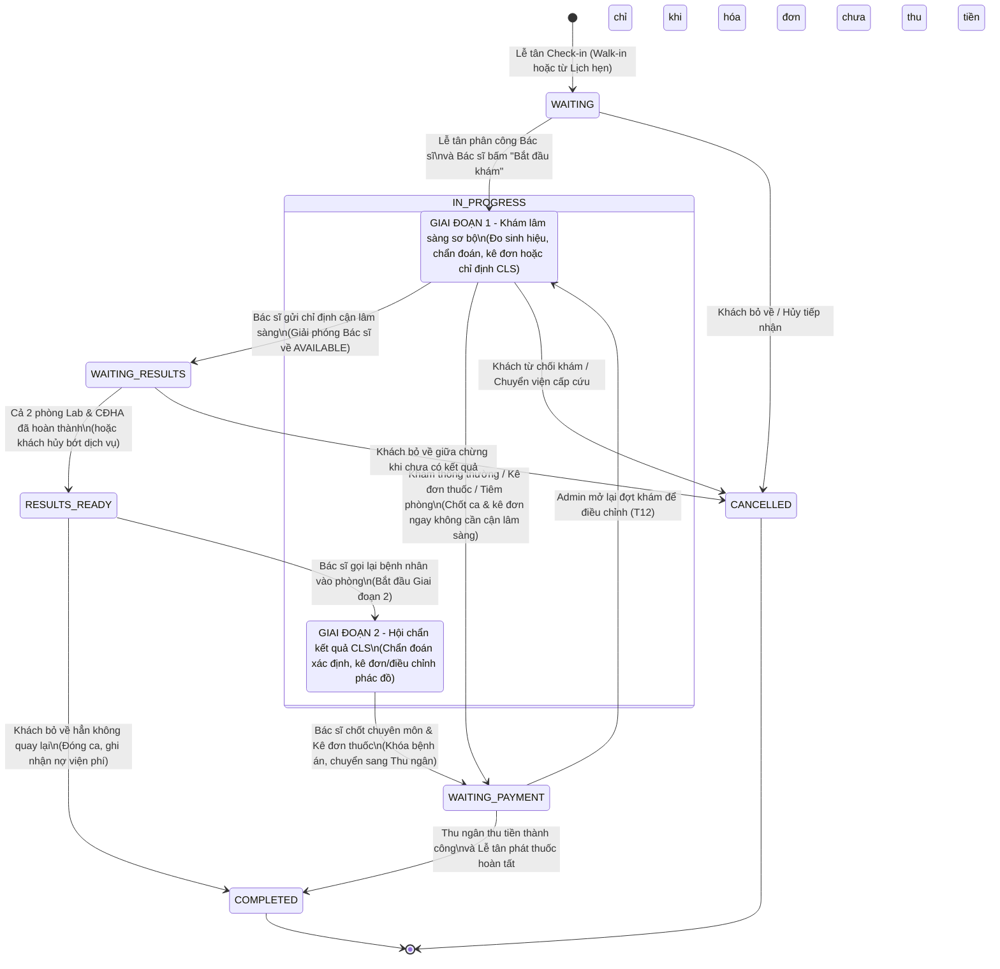
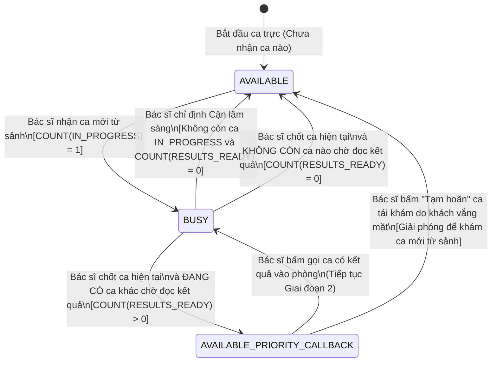
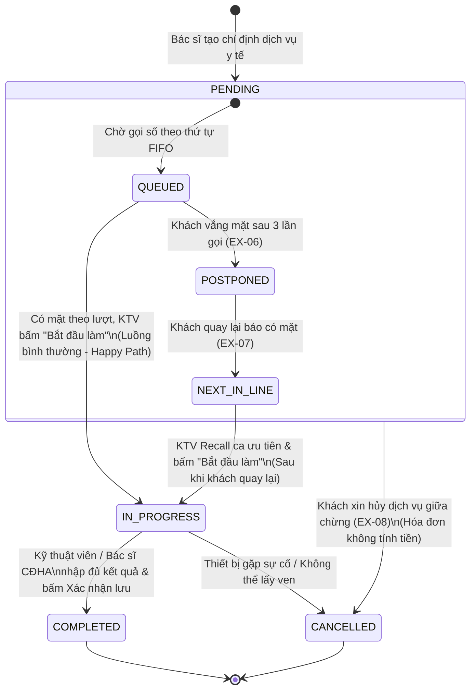
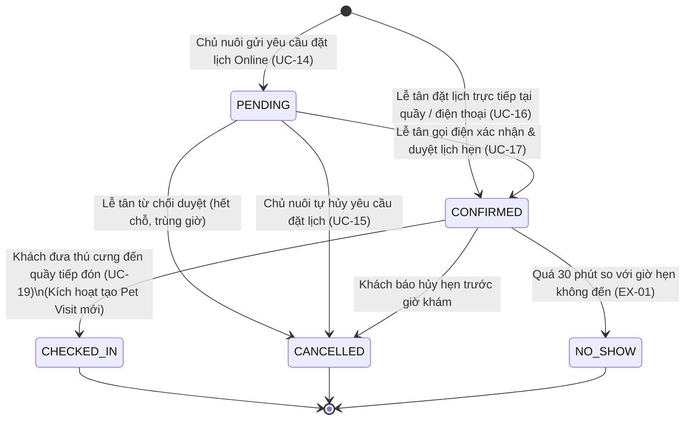
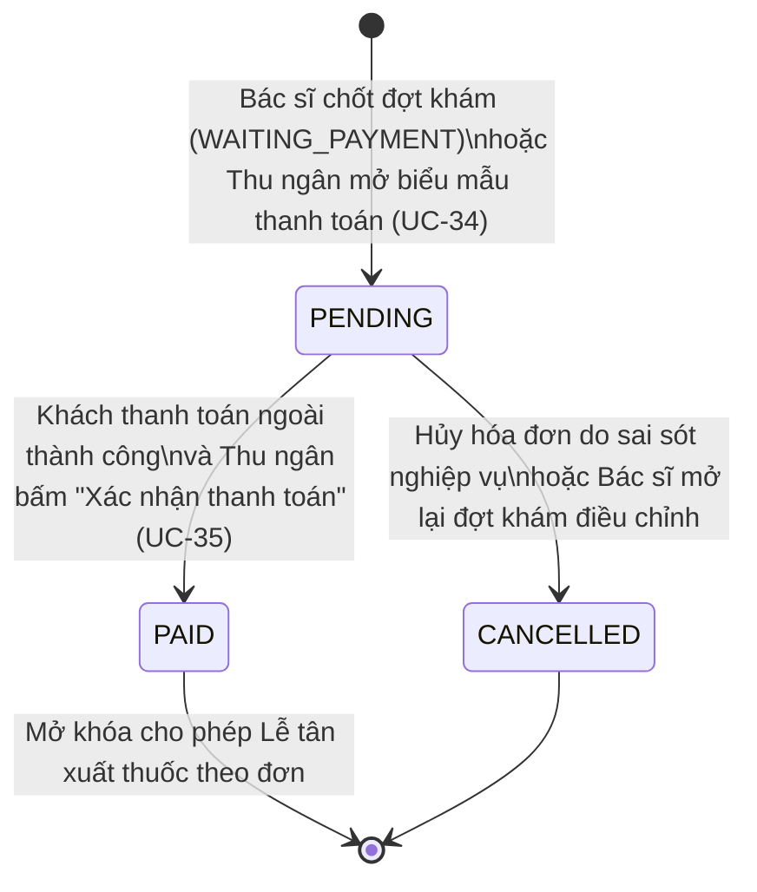
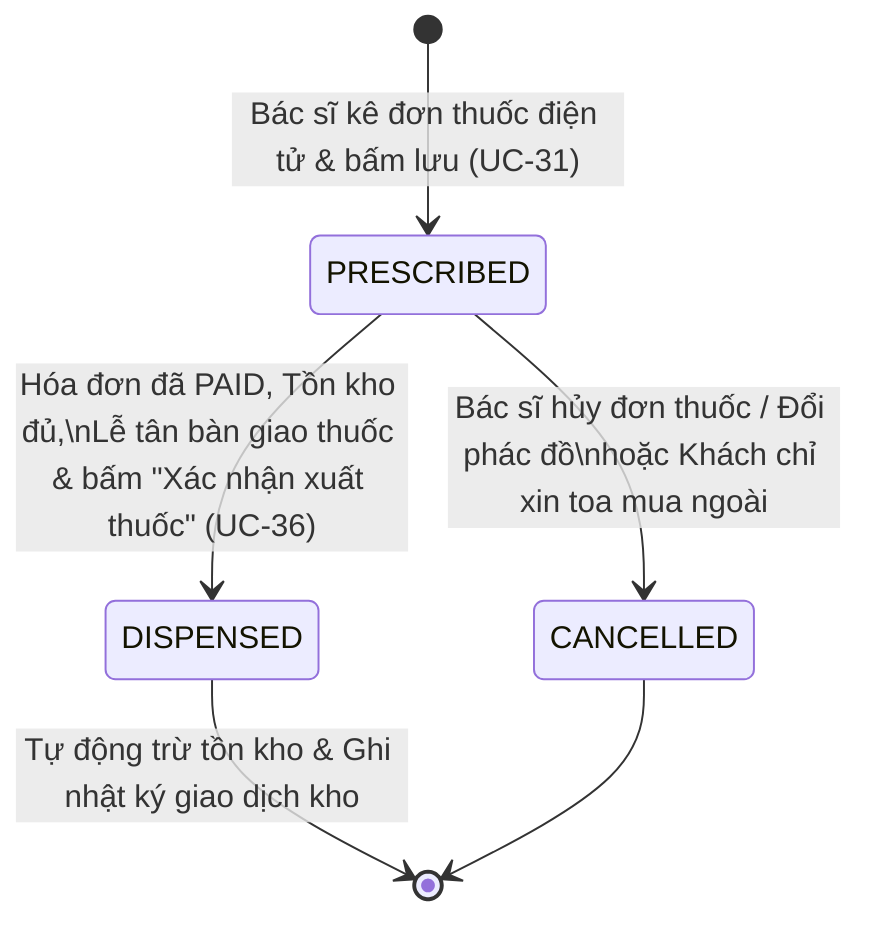

# THIẾT KẾ SƠ ĐỒ TRẠNG THÁI (STATE MACHINE DIAGRAMS)
## HỆ THỐNG QUẢN LÝ PHÒNG KHÁM THÚ Y

> **Tài liệu chuẩn UML / RUP phục vụ Báo cáo & Bảo vệ Đồ án tốt nghiệp**  
> **Mục tiêu:** Mô tả chi tiết không gian trạng thái, sự kiện kích hoạt (Trigger Events), điều kiện canh (Guard Conditions) và hành động chuyển đổi (State Transitions) của các thực thể nghiệp vụ cốt lõi và thực thể hỗ trợ trong hệ thống; kèm theo sơ đồ điều phối đồng bộ liên thực thể (Cross-Entity State Orchestration).

---

## MỤC LỤC TỔNG QUAN

1. [Sơ đồ Điều phối Đồng bộ Trạng thái Đa thực thể (Cross-Entity State Orchestration)](#1-sơ-đồ-điều-phối-đồng-bộ-trạng-thái-đa-thực-thể)
2. [State Machine 1: Đợt khám bệnh (Pet Visit)](#2-state-machine-1-đợt-khám-bệnh-pet-visit)
3. [State Machine 2: Trạng thái phục vụ tức thời của Bác sĩ (Doctor Serving Status)](#3-state-machine-2-trạng-thái-phục-vụ-tức-thời-của-bác-sĩ)
4. [State Machine 3: Chi tiết Chỉ định Dịch vụ Kỹ thuật (Visit Service Detail)](#4-state-machine-3-chi-tiết-chỉ-định-dịch-vụ-kỹ-thuật)
5. [State Machine 4: Lịch hẹn khám (Appointment)](#5-state-machine-4-lịch-hẹn-khám-appointment)
6. [State Machine 5: Hóa đơn thanh toán Viện phí (Invoice)](#6-state-machine-5-hóa-đơn-thanh-toán-viện-phí-invoice)
7. [State Machine 6: Đơn thuốc y tế (Prescription)](#7-state-machine-6-đơn-thuốc-y-tế-prescription)

---

## 1. SƠ ĐỒ ĐIỀU PHỐI ĐỒNG BỘ TRẠNG THÁI ĐA THỰC THỂ

Trong thực tế vận hành phòng khám thú y, các thực thể dữ liệu không biến đổi độc lập mà có sự ràng buộc, đồng bộ và kích hoạt lẫn nhau theo mô hình **Sự kiện - Ràng buộc (Event-Driven State Machine)**.



---

## 2. STATE MACHINE 1: ĐỢT KHÁM BỆNH (PET VISIT)

### 2.1. Ý nghĩa & Vai trò nghiệp vụ
Bảng `pet_visits` là **thực thể trung tâm (Core Aggregate Root)** của toàn bộ phần mềm. Vòng đời của một đợt khám được thiết kế theo mô hình **Chu kỳ Y tế Bất đồng bộ (Asynchronous Clinical Cycle)** để tối ưu hóa công suất phòng khám và loại bỏ triệt để điểm nghẽn thời gian thực.

### 2.2. Sơ đồ Trạng thái (Mermaid State Machine)



### 2.3. Bảng Ma trận Chuyển đổi Trạng thái (State Transition Table)

| STT | Trạng thái nguồn | Sự kiện kích hoạt (Trigger) | Điều kiện canh (Guard Condition) | Hành động CSDL & Tác động hệ thống | Trạng thái đích |
| :---: | :--- | :--- | :--- | :--- | :--- |
| **T01** | `[*] (None)` | Lễ tân tiếp đón khách tại quầy (UC-19) | Thông tin thú cưng hợp lệ; Cân nặng, nhiệt độ > 0 | Tạo bản ghi `pet_visits` mới, `checked_in_at = NOW()`. Xếp vào hàng đợi sảnh. | `WAITING` |
| **T02** | `WAITING` | Bác sĩ bấm *"Bắt đầu khám"* (UC-22) | Bác sĩ đã được phân công và đang ở trạng thái `AVAILABLE` | Cập nhật `started_at = NOW()`. Trạng thái Bác sĩ suy ra chuyển thành `BUSY`. Mở Bệnh án điện tử. | `IN_PROGRESS` (GĐ 1) |
| **T03** | `WAITING` | Lễ tân hủy ca khám (EX-03) | Khách xin về hoặc chờ quá lâu bỏ về | Cập nhật `closed_at = NOW()`, ghi nhận `cancel_reason`. Rút khỏi hàng đợi sảnh. | `CANCELLED` |
| **T04** | `IN_PROGRESS` (GĐ 1) | Bác sĩ xác nhận chỉ định cận lâm sàng (UC-23) | Có ít nhất 1 dịch vụ kỹ thuật được chỉ định | Tạo các dòng `visit_service_details` (`PENDING`). Giải phóng trạng thái Bác sĩ về `AVAILABLE`. | `WAITING_RESULTS` |
| **T05** | `IN_PROGRESS` (GĐ 1) | Bác sĩ chốt ca khám thông thường / kê đơn / tiêm phòng (UC-30_33) | Không chỉ định cận lâm sàng; Đã nhập `diagnosis`; Kê đơn thuốc ngoại trú (nếu có) | Cập nhật `closed_at = NOW()`. Khóa hồ sơ chuyên môn. Tạo đơn thuốc (nếu có), tạo hóa đơn viện phí tạm tính. | `WAITING_PAYMENT` |
| **T06** | `WAITING_RESULTS` | Phòng Lab & CĐHA hoàn tất nhập kết quả (UC-25_26) | `COUNT(*) WHERE status IN ('PENDING', 'IN_PROGRESS') == 0` | Đẩy ca vào Hàng đợi ưu tiên của Bác sĩ. Trạng thái Bác sĩ chuyển sang `AVAILABLE_PRIORITY_CALLBACK`. | `RESULTS_READY` |
| **T07** | `RESULTS_READY` | Bác sĩ bấm *"Mời vào phòng"* (UC-30) | Bác sĩ vừa kết thúc ca trước, bấm gọi ca có kết quả | Bật thông báo mời vào phòng. Trạng thái Bác sĩ chuyển thành `BUSY`. Mở giao diện Giai đoạn 2. | `IN_PROGRESS` (GĐ 2) |
| **T08** | `RESULTS_READY` | Thao tác *"Đóng ca / Khách bỏ về"* (EX-11) | Khách bỏ về hẳn không quay lại đọc kết quả | Cập nhật `closed_at = NOW()`, `completed_at = NOW()`. Khóa bệnh án, lưu kết quả, ghi nợ viện phí. | `COMPLETED` (Khóa) |
| **T09** | `IN_PROGRESS` (GĐ 2) | Bác sĩ chốt đợt khám & kê đơn (UC-30_33) | Đã nhập `diagnosis`; Đơn thuốc (nếu có) hợp lệ | Cập nhật `closed_at = NOW()`. Khóa bệnh án. Tạo `invoices` (`PENDING`). Giải phóng Bác sĩ. | `WAITING_PAYMENT` |
| **T10** | `WAITING_PAYMENT` | Thu ngân thu tiền & Lễ tân phát thuốc (UC-34_36) | Hóa đơn đã `PAID` và Đơn thuốc đã `DISPENSED` (hoặc không kê thuốc) | Cập nhật `completed_at = NOW()`. Lưu bệnh án vĩnh viễn, giải phóng ca khám khỏi màn hình thu ngân. | `COMPLETED` |
| **T11** | `IN_PROGRESS` (GĐ 1) | Khách từ chối khám lâm sàng / Chuyển viện | Khách xin dừng khám hoặc cần chuyển viện cấp cứu | Ghi nhận `cancel_reason`. Giải phóng Bác sĩ về `AVAILABLE`. | `CANCELLED` |
| **T12** | `WAITING_PAYMENT` | Admin mở lại đợt khám để điều chỉnh chuyên môn (sai chỉ định / sai đơn thuốc) | Hóa đơn chưa thu tiền (`PENDING`); Bác sĩ phụ trách không ở trạng thái `BUSY`; bắt buộc nhập lý do | Hủy hóa đơn `PENDING` (SM-05 `CANCELLED`), xóa `closed_at`, mở khóa hồ sơ bệnh án. Bác sĩ chốt lại bằng UC-30_33: hóa đơn cũ được dựng lại với nội dung mới. Ca đã thu tiền hoặc `COMPLETED` không mở lại được. | `IN_PROGRESS` |

---

## 3. STATE MACHINE 2: TRẠNG THÁI PHỤC VỤ TỨC THỜI CỦA BÁC SĨ (DOCTOR SERVING STATUS)

### 3.1. Ý nghĩa & Vai trò nghiệp vụ
Hệ thống **không sử dụng cột trạng thái tĩnh trong CSDL** để quản lý bác sĩ, nhằm triệt tiêu rủi ro sai lệch dữ liệu (Desynchronization) khi có sự cố mạng. Trạng thái phục vụ của Bác sĩ được **tính toán động theo thời gian thực (Computed State)** dựa trên tình trạng các ca khám mà Bác sĩ đó đang phụ trách.

### 3.2. Sơ đồ Trạng thái (Mermaid State Machine)



### 3.3. Quy tắc Suy diễn Trạng thái (Inference Logic)

```sql
-- Công thức tính trạng thái Bác sĩ :doctor_id tại thời điểm t
SELECT 
    CASE 
        WHEN COUNT(CASE WHEN status = 'IN_PROGRESS' THEN 1 END) > 0 
            THEN 'BUSY'
        WHEN COUNT(CASE WHEN status = 'RESULTS_READY' THEN 1 END) > 0 
            THEN 'AVAILABLE_PRIORITY_CALLBACK'
        ELSE 'AVAILABLE'
    END AS computed_doctor_status
FROM pet_visits 
WHERE doctor_id = :doctor_id 
  AND status IN ('IN_PROGRESS', 'RESULTS_READY');
```

### 3.4. Bảng Chi tiết Chuyển đổi Trạng thái Bác sĩ

| Trạng thái nguồn | Sự kiện kích hoạt | Cơ chế nghiệp vụ & Ràng buộc bảo vệ | Trạng thái đích |
| :--- | :--- | :--- | :--- |
| `AVAILABLE` | Lễ tân phân công ca khám mới & Bác sĩ bấm bắt đầu khám | Bác sĩ đang rảnh hoàn toàn, tiếp nhận bệnh nhân bước vào phòng khám. | `BUSY` |
| `BUSY` | Bác sĩ gửi phiếu chỉ định cận lâm sàng (Giai đoạn 1) | Ca khám chuyển `WAITING_RESULTS`. Bác sĩ được giải phóng ngay lập tức để không bị lãng phí thời gian chờ máy chạy kết quả. | `AVAILABLE` (nếu không có ca chờ KQ khác) |
| `BUSY` | Bác sĩ chốt đợt khám (Giai đoạn 2 hoặc ca khám nhẹ) | Bác sĩ khám xong, hệ thống phát hiện có ít nhất 1 ca đã có kết quả xét nghiệm (`RESULTS_READY`). **Khóa ưu tiên (Priority Lock)** được kích hoạt: Nút phân công ca mới của Lễ tân bị disable. | `AVAILABLE_PRIORITY_CALLBACK` |
| `AVAILABLE_PRIORITY_CALLBACK` | Bác sĩ bấm nút *"Mời vào phòng"* trên hộp thoại nổi bật | Bác sĩ đón ca tái khám vào phòng để đọc kết quả và kê đơn. Trạng thái trở lại bận. | `BUSY` |
| `AVAILABLE_PRIORITY_CALLBACK` | Bác sĩ bấm nút *"Tạm hoãn / Gọi ca tiếp"* (EX-10) | Thông báo gọi 3 lần khách không vào. Bác sĩ tạm hoãn ca tái khám. Hệ thống giải phóng Bác sĩ về `AVAILABLE` để Lễ tân có thể phân ca mới từ sảnh, tránh làm treo phòng khám. | `AVAILABLE` |

---

## 4. STATE MACHINE 3: CHI TIẾT CHỈ ĐỊNH DỊCH VỤ KỸ THUẬT (VISIT SERVICE DETAIL)

### 4.1. Ý nghĩa & Vai trò nghiệp vụ
Bảng `visit_service_details` quản lý tiến độ thực hiện của từng dịch vụ kỹ thuật độc lập (Xét nghiệm máu CBC, Siêu âm bụng, Chụp X-quang, Tiêm vaccine) trong 2 hàng đợi chuyên môn độc lập (Phòng Lab và Phòng Chẩn đoán hình ảnh).

### 4.2. Sơ đồ Trạng thái (Mermaid State Machine)



### 4.3. Bảng Ma trận Chuyển đổi Trạng thái Dịch vụ

| Trạng thái nguồn | Sự kiện kích hoạt | Điều kiện / Nghiệp vụ | Tác động CSDL & Hóa đơn | Trạng thái đích |
| :--- | :--- | :--- | :--- | :--- |
| `[*] (None)` | Bác sĩ gửi phiếu chỉ định | Bác sĩ chọn dịch vụ từ danh mục `services` | Tạo dòng `visit_service_details`, snapshot `unit_price`, gán `status = 'PENDING'`. | `PENDING` |
| `PENDING` (`QUEUED`) | Gọi số nhưng khách vắng mặt (EX-06) | Thông báo gọi 3 lần khách không vào | Giữ nguyên `status = 'PENDING'`. Ca chuyển sang sub-state `POSTPONED` (Tab hoãn), gọi ca sau ngay. | `PENDING` (`POSTPONED`) |
| `PENDING` (`POSTPONED`) | Khách quay lại sau khi bị hoãn (EX-07) | Khách bấm "Tôi đã có mặt" | Giữ nguyên `status = 'PENDING'`. Chuyển sang sub-state `NEXT_IN_LINE` (Ghim ưu tiên kế tiếp). | `PENDING` (`NEXT_IN_LINE`) |
| `PENDING` | Bắt đầu thực hiện chuyên môn | Thú cưng đã vào phòng lấy ven / lên bàn chụp | Cập nhật `status = 'IN_PROGRESS'`. Bắt đầu tiêu hao vật tư. | `IN_PROGRESS` |
| `PENDING` | Khách xin hủy dịch vụ (EX-08) | Khách không đủ kinh phí hoặc thú cưng quá hung dữ | Cập nhật `status = 'CANCELLED'`. **Tuyệt đối không tính tiền dịch vụ này trên hóa đơn viện phí**. | `CANCELLED` |
| `IN_PROGRESS` | Lưu kết quả chuyên môn (UC-25_26) | Nhập đủ chỉ số máu / Tải tệp ảnh chụp X-quang | Cập nhật `status = 'COMPLETED'`. Lưu vào `lab_test_results` hoặc `imaging_results`. Đánh giá kích hoạt `RESULTS_READY` cho đợt khám. | `COMPLETED` |

---

## 5. STATE MACHINE 4: LỊCH HẸN KHÁM (APPOINTMENT)

### 5.1. Ý nghĩa & Vai trò nghiệp vụ
Bảng `appointments` quản lý vòng đời của yêu cầu đặt lịch hẹn trước của chủ nuôi (qua Cổng trực tuyến hoặc đặt tại quầy/điện thoại). Hệ thống duy trì liên kết lỏng (Loose Coupling) giữa Lịch hẹn và Ca khám thực tế.

### 5.2. Sơ đồ Trạng thái (Mermaid State Machine)



### 5.3. Bảng Ma trận Chuyển đổi Trạng thái Lịch hẹn

| Trạng thái nguồn | Sự kiện kích hoạt | Điều kiện canh (Guard) | Tác động hệ thống & CSDL | Trạng thái đích |
| :--- | :--- | :--- | :--- | :--- |
| `[*] (None)` | Khách đặt lịch qua Portal (UC-14) | Khung giờ còn sức chứa (`current_booked < max_capacity`) | Tạo bản ghi `appointments` với `status = 'PENDING'`. Tạm giữ chỗ. | `PENDING` |
| `[*] (None)` | Lễ tân tạo lịch tại quầy/điện thoại (UC-16) | Thông tin khách hàng và thú cưng hợp lệ | Tạo bản ghi với `status = 'CONFIRMED'` ngay lập tức. | `CONFIRMED` |
| `PENDING` | Lễ tân duyệt lịch hẹn (UC-17) | Lễ tân gọi điện xác thực thành công | Cập nhật `status = 'CONFIRMED'`. Gửi thông báo xác nhận đến Portal khách hàng. | `CONFIRMED` |
| `PENDING` | Lễ tân từ chối hoặc khách tự hủy (UC-15) | Bắt buộc nhập lý do từ chối | Cập nhật `status = 'CANCELLED'`. Giải phóng suất đặt chỗ của khung giờ. | `CANCELLED` |
| `CONFIRMED` | Khách đến phòng khám tiếp nhận (UC-19) | Khách có mặt tại quầy đúng ngày hẹn | Cập nhật `status = 'CHECKED_IN'`. Tạo bản ghi `pet_visits` (`WAITING`) liên kết với `appointment_id`. | `CHECKED_IN` |
| `CONFIRMED` | Tự động quét vắng mặt (EX-01) | Thời gian hiện tại > `appointment_time + 30 phút` | Cập nhật `status = 'NO_SHOW'`. Hủy giữ chỗ, nhường lượt cho khách vãng lai. | `NO_SHOW` |

---

## 6. STATE MACHINE 5: HÓA ĐƠN THANH TOÁN VIỆN PHÍ (INVOICE)

### 6.1. Ý nghĩa & Vai trò nghiệp vụ
Bảng `invoices` quản lý chứng từ tài chính viện phí của từng ca khám. Một ca khám có tối đa 1 hóa đơn thanh toán duy nhất (`visit_id UNIQUE`).

### 6.2. Sơ đồ Trạng thái (Mermaid State Machine)



### 6.3. Bảng Ma trận Chuyển đổi Trạng thái Hóa đơn

| Trạng thái nguồn | Sự kiện kích hoạt | Điều kiện canh (Guard) | Tác động hệ thống & CSDL | Trạng thái đích |
| :--- | :--- | :--- | :--- | :--- |
| `[*] (None)` | Ca khám chuyển sang `WAITING_PAYMENT` | Bác sĩ đã chốt chuyên môn và khóa hồ sơ bệnh án | Tạo mã hóa đơn duy nhất (`INV-YYYY-XXXX`). Tổng hợp tiền khám, cận lâm sàng và tiền thuốc. | `PENDING` |
| `PENDING` | Thu ngân bấm *"Xác nhận thanh toán"* (UC-35) | `discount_amount <= total_amount` (EX-14); Đã nhận đủ tiền bên ngoài quầy | Cập nhật `payment_status = 'PAID'`, `paid_at = NOW()`, `cashier_id = :id`. Mở khóa quyền xuất thuốc theo đơn. In phiếu thanh toán. | `PAID` |
| `PENDING` | Thu ngân hủy hóa đơn | Phát hiện sai sót chỉ định hoặc khách xin điều chỉnh | Cập nhật `payment_status = 'CANCELLED'`. Cho phép Bác sĩ mở lại hồ sơ để hiệu chỉnh. | `CANCELLED` |

---

## 7. STATE MACHINE 6: ĐƠN THUỐC Y TẾ (PRESCRIPTION)

### 7.1. Ý nghĩa & Vai trò nghiệp vụ
Bảng `prescriptions` đảm bảo quản lý chặt chẽ vòng đời cấp phát thuốc, ngăn chặn tình trạng thất thoát kho và phòng ngừa xuất trùng lặp thuốc (Double-Dispensing).

### 7.2. Sơ đồ Trạng thái (Mermaid State Machine)



### 7.3. Bảng Ma trận Chuyển đổi Trạng thái Đơn thuốc

| Trạng thái nguồn | Sự kiện kích hoạt | Điều kiện canh (Guard) | Tác động hệ thống & CSDL | Trạng thái đích |
| :--- | :--- | :--- | :--- | :--- |
| `[*] (None)` | Bác sĩ nhấn *"Lưu đơn thuốc"* (UC-31) | Số lượng kê $\le$ Tồn kho khả dụng (`stock_quantity >= quantity`) | Tạo bản ghi `prescriptions` (`PRESCRIBED`), snapshot `unit_price` vào `prescription_items`. | `PRESCRIBED` |
| `PRESCRIBED` | Lễ tân bấm *"Xác nhận xuất thuốc"* (UC-36) | Hóa đơn liên kết đã là `PAID`; Tồn kho thực tế tại thời điểm bấm vẫn đủ (EX-15, EX-16) | Giao dịch an toàn (`@Transactional`): Trừ `medicines.stock_quantity`, ghi bản ghi `inventory_transactions` (`EXPORT_PRESCRIPTION`), cập nhật `status = 'DISPENSED'`. | `DISPENSED` |
| `PRESCRIBED` | Hủy đơn thuốc | Khách không mua thuốc tại phòng khám hoặc đổi thuốc | Cập nhật `status = 'CANCELLED'`. Tồn kho kho không bị biến động. | `CANCELLED` |

---

## TỔNG KẾT TÍNH NHẤT QUÁN TOÀN HỆ THỐNG

| Mã thực thể | Tên thực thể CSDL | Cột trạng thái | Số lượng trạng thái | Văn bản tham chiếu liên quan |
| :--- | :--- | :--- | :---: | :--- |
| **SM-01** | `pet_visits` | `status` | 7 | [DAC_TA_USE_CASE_CORE.md](file:///c:/Users/Admin/Desktop/Đồ%20án%20tốt%20nghiệp/DAC_TA_USE_CASE_CORE.md) (UC-19, 22, 25, 30, 34, 36) |
| **SM-02** | *Computed Doctor* | `doctor_serving_status` | 3 | [THIET_KE_CO_SO_DU_LIEU_ERD.md](file:///c:/Users/Admin/Desktop/Đồ%20án%20tốt%20nghiệp/THIET_KE_CO_SO_DU_LIEU_ERD.md) (Nguyên tắc 5) |
| **SM-03** | `visit_service_details`| `status` | 4 | [DANH_SACH_KIEU_ENUM_HE_THONG.md](file:///c:/Users/Admin/Desktop/Đồ%20án%20tốt%20nghiệp/DANH_SACH_KIEU_ENUM_HE_THONG.md) (Enum #13) |
| **SM-04** | `appointments` | `status` | 5 | [DANH_SACH_KIEU_ENUM_HE_THONG.md](file:///c:/Users/Admin/Desktop/Đồ%20án%20tốt%20nghiệp/DANH_SACH_KIEU_ENUM_HE_THONG.md) (Enum #5) |
| **SM-05** | `invoices` | `payment_status` | 3 | [DANH_SACH_KIEU_ENUM_HE_THONG.md](file:///c:/Users/Admin/Desktop/Đồ%20án%20tốt%20nghiệp/DANH_SACH_KIEU_ENUM_HE_THONG.md) (Enum #12) |
| **SM-06** | `prescriptions` | `status` | 3 | [DANH_SACH_KIEU_ENUM_HE_THONG.md](file:///c:/Users/Admin/Desktop/Đồ%20án%20tốt%20nghiệp/DANH_SACH_KIEU_ENUM_HE_THONG.md) (Enum #9) |
